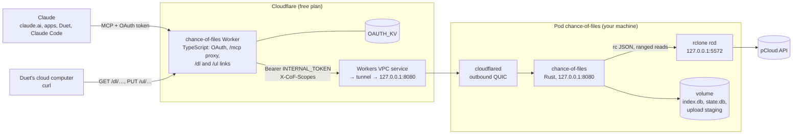

# Chance of Files

*Cloudy, with a chance of files:* your pCloud, raining down into Claude's context.

Let **Claude** read and organize the files in your **pCloud**: text and images, folders and big transfers, from claude.ai, the Claude apps, Claude Code and **Claude Duet**, through a custom connector you host yourself.

pCloud has an [official MCP server](https://mcp.pcloud.com/mcp), and it's good at organizing files, but none of its tools return what's inside one, and none can tell you where your space went. Chance of Files fills those gaps: Claude can list, search and read text files and images anywhere in your drive, except the folders you hide, and audit the whole drive from a metadata index the core keeps itself: the biggest folders and files, duplicates, what changed lately, which file types take the space. Since 0.4 it can also change things, only on connections you allow to, and with Claude asking you before each change: create folders, move, rename, copy, write small files, and delete to pCloud's trash. And it hands out short-lived download and upload links, so Claude Duet's cloud computer can move gigabytes in and out with `curl`.

It has two halves:

- **The core**, a Rust server (`chance-of-files`) that runs next to `rclone rcd` and `cloudflared` in one pod on any Kubernetes or k3s node you have (a NAS, a mini PC, a Raspberry Pi 5), or as three containers on a plain Docker host. rclone talks to pCloud's API with its own registered app, so no pCloud Drive mount and no laptop are involved.
- **The auth Worker**, a small TypeScript Worker on Cloudflare's **free** plan. It's the URL you add to Claude; it handles OAuth and forwards requests to the core through a Workers VPC service and a Cloudflare Tunnel that has no public hostname. Nothing on your network listens to the internet.

Chance of Files is an independent, self-hosted project. It is not affiliated with, endorsed by or supported by pCloud or Anthropic; "pCloud" and "Claude" are their owners' trademarks, used here only to say what this works with.

## Status

**0.4, November 2026: writes and links.** Write tools behind a separate `files:write` grant, each marked destructive so Claude asks first; deletes go to pCloud's trash; `policy.protected` folders (a photo backup, say) are never written. Folder moves, copies and deletes run as background jobs (`job_status`). Expiring links through the auth Worker: single files with `Range` resume, whole folders as streamed zips, and chunked uploads in parts of up to 90 MiB.

**0.3, October 2026: whole-drive audit.** The core keeps a metadata index of your drive in SQLite on the pod's volume, walked every 30 minutes by default, and answers audit questions from it in one or two calls ("where did my 408 GiB go", "all .mov files over 1 GB", "what are my duplicates") without walking pCloud each time. `list_folder` and `search_files` now answer from the index too, so they're fast on folders with a hundred thousand files.

**0.2, October 2026.** The core moved off Cloudflare Workers onto your own machine ([design](docs/design/v2.md)), with the same five read tools as 0.1. pCloud removed password sign-in from its API in April 2026 and approves OAuth apps by hand; this project's request is pending, so the core reaches pCloud through rclone's remote-control API with an rclone `pcloud` remote you authorise once.

**0.1 (Workers only)** ran the core as a second Worker and read pCloud through the pCloud Drive mount on a laptop. It's frozen at tag [`v0.1.0`](https://github.com/tywrr/chance-of-files/tree/v0.1.0); its README and setup guide are there.

## Chance of Files or pCloud's own MCP server?

| | [pCloud MCP](https://mcp.pcloud.com/mcp) (official) | Chance of Files 0.4 |
|---|---|---|
| Hosted by | pCloud | You: a pod on your own machine, plus a free Cloudflare Worker |
| List folders, search names, file info | Yes | Yes |
| Read text files | No | Yes, up to 100 kB per call, with offsets for longer files |
| Read images | No | Yes, up to 1.5 MiB by default |
| Whole-drive audit: folder totals, largest files, duplicates, recent changes, space by type | No | Yes, from its own index |
| Create, copy, move, rename, upload | Yes | Yes, behind a separate `files:write` consent; Claude asks before each change; protected folders refused |
| Delete | No | Yes, to pCloud's trash only |
| Links | Public share links | Private links that expire (15 minutes by default, at most 24 hours): file downloads, folder zips, chunked uploads; listed, logged, revocable |
| What Claude can reach | Your whole account | Your whole drive minus the paths you hide |

They don't conflict. Add both, and Claude organizes with pCloud's and reads with this one; the paths match.

## Tools

| Tool | Arguments | What Claude gets |
|---|---|---|
| `list_folder` | `path` (default `/`), `sort`, `cursor`, `live` | The folder's files and subfolders, with sizes, modified times and, for subfolders, their total size and file count. From the index; `live=true` asks pCloud instead |
| `get_file_info` | `path`, `hash` | Name, type, size, modified time and content type, checked live with pCloud; SHA-1 and MD5 on request; for a folder, its totals from the index |
| `read_text_file` | `path`, `offset` (default 0), `max_bytes` | Text from `offset`, at most `limits.max_read_bytes` (100,000) bytes per call; Claude calls again with a later offset to read on |
| `read_image` | `path` | The image itself (PNG, JPEG, GIF or WebP), if it's at most `limits.max_image_bytes` (1.5 MiB) |
| `search_files` | `query`, `path` (default `/`), `kind`, `cursor` | Files and folders anywhere under `path` whose **name** contains `query`, ignoring case and accents, from the index. It still leaves out the folders in `policy.search_skip` |
| `folder_stats` | `path`, `depth` (1–3), `sort`, `cursor` | The folders under `path` with their files, subfolders, total bytes and newest change: "where did my space go" |
| `query_files` | `path`, `kind`, `ext`, size and date bounds, `sort`, `cursor` | Files matching the bounds, sorted: "the 50 largest files", "every .mov over 1 GB since 2020" |
| `find_duplicates` | `path`, `min_size` (1 MiB), `cursor` | Groups of files with the same content: same size first, then the same SHA-1 (fetched from pCloud only for size collisions, and cached) |
| `recent_changes` | `since`, `path`, `source`, `cursor` | Files and folders added, changed, moved or removed, as seen by the index's walks |
| `type_breakdown` | `path` | Count and bytes per kind (image, video, document, …) and per extension |
| `index_status` | | Per root: when it was last walked, how many entries, the last error, any held mass removal; and whether pCloud answers |
| `refresh_index` | `path`, `confirm` | Starts a re-walk now (it runs in the background); `confirm=true` applies a held mass removal |
| `job_status` | `id` (none: recent jobs) | Progress of a folder move, copy or delete running in the background: `running`, `done`, `failed` or `lost` |
| `list_links` | `id` (none: all live links) | Your links: what each one serves, when it expires, bytes served of its cap, and every use (address, range, bytes, status) |
| `create_download_link` | `paths`, `zip` (false), `expires_in` (15 min, max 24 h) | One link per file, folders expanded, each resumable with `Range`, plus a manifest and a `curl` script; or with `zip=true`, one streamed zip of everything (up to 10 GB, not resumable) |
| `revoke_link` | `id` | Kills a link at once |

With the `files:write` grant (see [Security model](#security-model)):

| Tool | Arguments | What it does |
|---|---|---|
| `create_folder` | `path` | Creates the folder and any missing parents; fine if it exists |
| `move` | `from`, `to`, `overwrite` (false) | Moves or renames a file or folder (`to` an existing folder moves it inside). Files at once; folders as a job, on pCloud usually one server-side rename |
| `copy` | `from`, `to`, `overwrite` (false) | Copies on pCloud's side, nothing passes through your machine; folders as a job |
| `write_file` | `path`, `text` or `base64`, `overwrite` (false) | Writes a small file (up to 5 MB); bigger ones go through an upload link |
| `delete` | `path` | Moves a file or folder to **pCloud's trash**, where you can restore it from pCloud's web UI. Never deletes permanently |
| `create_upload_link` | `folder`, `name`, `size`, `overwrite` (false), `expires_in` | A link to upload one file into an existing folder in parts of up to 90 MiB, with a ready-to-run `split` + `curl` script; reserves `size` of staging space |

**Claude asks you before each change and each link.** Every write tool, `create_download_link`, `create_upload_link` and `revoke_link` is annotated `destructiveHint: true`, so Claude shows you the call and waits for your yes. A download link counts as a change, because it lets data leave your drive. Writes are refused anywhere under a `policy.protected` folder, including moves and copies into or out of one; hidden folders stay "not found" for writes too. Read tools need only the `files:read` scope, which every sign-in grants; `refresh_index` changes only the core's own index, never your drive. Index results start with a header line that says how fresh they are (`/ as of 14:05Z`) and, when there are more rows, a cursor for the next page; every result stays under about 120,000 characters. If pCloud stops answering, index tools keep working and the header says `backend unhealthy since …`. An `/AGENTS.md` at the root of your drive, if you write one, goes into the instructions Claude gets when it connects: say there what each folder is for.

### Links, for Claude Duet and big files

Tool results are capped at about 150,000 characters, so files of any size travel by link instead. Ask Duet "zip my 2019 photos folder and put it on your computer": Claude calls `create_download_link` (you approve), gets `https://chance-of-files.<your-subdomain>.workers.dev/dl/<token>/<name>`, and runs `curl` on its cloud computer. Per-file links are the default; folders can also come as one zip. The other way, `create_upload_link` returns a script that splits the file into 90 MiB parts and `PUT`s them in order; the core assembles them on its volume, uploads the result to pCloud and checks its size and SHA-1. Rerunning the script resumes an upload.

- **Allow the host once.** Duet's computer only reaches hosts on its network allowlist: add `chance-of-files.<your-subdomain>.workers.dev` (the host alone, no path) in Duet's network settings. Links never need anything else.
- **Short-lived.** A link lasts 15 minutes unless Claude asks for longer (at most 24 hours), moves at most 3 times its size (enough for retries), and is bound to the first network (/24) that uses it. `list_links` shows every use; `revoke_link` ends one early.
- **Resumable or not.** Single-file links support `Range`, so `curl -C -` picks up where a dropped transfer stopped. Zips are streamed as they're made and restart from zero if cut, so they stop at 10 GB; for more, or for anything you'd hate to restart, use per-file links.

Measured through the free Worker from a home connection: ~18–20 MiB/s down, ~11 MiB/s up; 2 GiB each way arrived intact ([phase 0](docs/design/phase0-network.md)).

## How it works



1. Claude calls `https://chance-of-files.<your-subdomain>.workers.dev/mcp` with an OAuth access token. The auth Worker checks it, replaces it with the internal token, adds the grant's scopes as `X-CoF-Scopes`, and forwards the request over its VPC service binding.
2. The binding reaches the pod through a Cloudflare Tunnel; cloudflared hands the request to the core on loopback.
3. The core checks the internal token, applies your path policy (hidden folders never reach rclone), and runs the tool: listing, search and audit tools answer from the index; reads and `get_file_info` call rclone's remote-control API, which calls pCloud.
4. Writes go through rclone to pCloud; once pCloud confirms, the core updates its index at once (so the next walk doesn't undo it). Folder moves, copies and deletes run as rclone jobs, recorded in `state.db`; when one finishes, the core re-walks the folders it touched.
5. A link request (`/dl/…`, `/ul/…`) reaches the Worker, which checks the link's signature and expiry before anything reaches your network, then forwards it the same way. The core checks the link against `state.db` (revoked? over its byte cap? another network?), logs the use, and streams: a file from rclone with the range it asked for, a zip built on the fly, or an upload part into a staging directory on the volume.
6. In the background the core walks each configured root (every 30 minutes by default) and updates the index; hidden folders are never fetched, not even their names.

[docs/architecture.md](docs/architecture.md) has the details and the reasons.

## Security model

- **Only you can connect.** The sign-in page asks for a passphrase only you know; there are no accounts. Attempts are rate limited, Claude gets tokens for this server's `/mcp` only, refresh tokens rotate, and the KV store keeps only token hashes.
- **Read and write are separate grants.** Every sign-in gets `files:read`; `files:write` only when you tick an unticked-by-default box on the consent page. Without it the write tools aren't listed and calls to them are refused. To change it, reconnect. `[writes] tools` in the config narrows it further for the whole server (empty: read-only).
- **Claude asks before every change and every link**, and deletes go to pCloud's trash, never further: the core has no way to empty it or delete permanently.
- **Protected folders are never written.** `policy.protected` (say `/Backups/Immich`) stays visible, readable and linkable, but every write at or under it is refused, as is any move or copy into or out of it, and any move, copy or delete of a folder that contains it.
- **Links are short-lived and accounted for.** 128 random bits plus an HMAC (`LINK_KEY`) make a link unguessable; the Worker rejects bad or expired ones before they reach your network. Each expires in 15 minutes by default, stops after 3 times its payload, is listed with every use in `list_links`, and can be revoked. The first network (/24) to use a link binds it, but that's a minor layer: Claude's and Duet's traffic leaves from Anthropic's shared addresses, so it keeps out the open internet, not other Claude users. Rotating `LINK_KEY` kills every link at once.
- **Nothing listens on your network.** cloudflared dials out; the tunnel has no public hostname and is reachable only from Workers bound to its VPC service. The core and rclone listen on the pod's loopback, a NetworkPolicy denies all ingress, and the pod runs under the `restricted` Pod Security profile (non-root, read-only root filesystem, no capabilities, no service-account token, no hostPath).
- **Hidden paths are enforced in one place.** The core's `policy.hidden` list is checked on normalized paths before any rclone call, and the index walks go around hidden folders without fetching them, so their names are never in `index.db`; rclone itself runs with no filters (they don't stop single-object calls, and they'd slow listings down; see [phase 0](docs/design/phase0-rclone.md)). Hide your Crypto Folder and anything else Claude shouldn't see.
- **The internal token is the core's only door.** The core refuses every `/mcp` request without it (constant-time compare) and trusts `X-CoF-Scopes` only on requests that carry it. rclone's rc password never leaves the pod.

What it doesn't protect against:

- **Anything not hidden can reach Claude.** Hide IDs, tax papers and password exports, or keep them outside pCloud.
- **File contents and names are untrusted input.** A file, or a file name in a listing, can contain instructions aimed at Claude (prompt injection). With `files:write`, such a file could ask Claude to move, delete or link things. That's why Claude asks before every change and link: read what you approve. Connect read-only when you don't need changes; trash and `protected` limit the damage of a mistaken yes.
- **Cloudflare and Anthropic see the traffic.** TLS ends at Cloudflare's edge, as with any Worker, and tool results pass through Anthropic, as with any connector.

## Limitations

- **A machine that runs containers, always on.** A single-node k3s on a NAS is the reference setup; any Kubernetes works, and so does Docker (see [setup](docs/setup.md#running-on-plain-docker)). At rest the pod uses roughly 150 MB of RAM (rclone idles at about 85 MB); a walk of a 133k-file folder briefly takes rclone to about 440 MB.
- **The index is as fresh as the last walk.** pCloud has no change feed for rclone's app, so the core polls: every 30 minutes by default, per root. Changes made elsewhere show up after the next walk (or `refresh_index`); headers say "as of" when. `get_file_info` and `list_folder live=true` always ask pCloud.
- **Workers VPC is free while it's in beta.** If that changes, the fallback is a tunnel public hostname behind Cloudflare Access ([design, Risks](docs/design/v2.md#risks)).
- **Claude's limits:** a tool result is capped at about 150,000 characters (reads are paged) and a call at 240 seconds; the core stops at 180 s (`server.deadline`), and long folder operations run as jobs instead.
- **Uploads go in parts.** Cloudflare caps every request body at 100 MB on the free plan, so uploads over 5 MB use an upload link with parts of up to 90 MiB. They're staged on the pod's volume before going to pCloud, so the volume needs free space for the biggest upload (`links.staging_max_bytes`).
- **Zips aren't resumable**, and capped at 10 GB by default; per-file links resume.
- **Your uplink sets the speed** of links: every byte goes pCloud → your machine → Cloudflare → Duet.
- **Claude Duet is a research preview.** It uses your claude.ai connectors when you talk to it; its scheduled and background runs may skip custom connectors.
- **claude.ai sometimes doesn't finish adding a custom connector, or hides its tools** even when it shows Connected ([anthropics/claude-ai-mcp#831](https://github.com/anthropics/claude-ai-mcp/issues/831), [#476](https://github.com/anthropics/claude-ai-mcp/issues/476)). See [troubleshooting](docs/setup.md#troubleshooting).
- **Text and images only, names only.** PDFs, Office files, mail and full-text search come in 0.5.

## Documentation

| Doc | Read it for |
|---|---|
| [Setup](docs/setup.md) | Running your own: the rclone remote, the tunnel and VPC service, the image, the pod, the auth Worker, the connector in Claude, links for Duet |
| [Development](docs/development.md) | The local loop, tests, building images, Claude Code and MCP Inspector |
| [Architecture](docs/architecture.md) | Components, request flow, auth layers and scopes, the index, the config file, limits |
| [Roadmap](docs/roadmap.md) | Mirror and full text, the pCloud API backend |
| [Design v2](docs/design/v2.md) | The full v2 design and the phase 0 measurements behind it |
| [Background](docs/background.md) | Why this exists, prior art, pCloud API gotchas (written for 0.1) |

## Development

```bash
mise install          # node, wrangler, rclone (Rust comes from rustup)
mise run dev          # rclone rcd over fixtures/webdav-root + the server on http://127.0.0.1:8080/mcp
mise run smoke        # another terminal: tools/list and every tool through the MCP Inspector CLI
mise run test         # cargo test --workspace and the auth front's tests
mise run lint         # fmt, clippy -D warnings, typecheck, shellcheck, kustomize render
mise run build-image  # static musl binaries -> OCI archives in target/oci
```

| Path | What |
|---|---|
| `crates/core` | The MCP endpoint, JSON-RPC, tools, `Storage` trait, policy and scopes. No I/O of its own |
| `crates/rclone` | `Storage` over rclone's remote-control API |
| `crates/webdav` | `Storage` over WebDAV, for a local folder or NAS |
| `crates/index` | The metadata index (SQLite): split walks, walk guards, folder totals, duplicate hashing, the audit queries |
| `crates/server` | The `chance-of-files` binary: axum, config, `/mcp`, the `/dl` and `/ul` link handlers, background walks and jobs, `/healthz`, `/readyz` |
| `auth/` | The TypeScript Worker `chance-of-files`: OAuth, the `/mcp` proxy, and the `/dl` and `/ul` link routes |
| `deploy/` | Kustomize base (`k8s/base`), `k8s/apply.sh`, `build-image.sh`, `oci-image.py`, `dev.sh` |
| `config.example.toml` | Every config option, documented |

## License

Chance of Files is an independent project, not affiliated with pCloud or Anthropic.

Licensed under either of [Apache License 2.0](LICENSE-APACHE) or [MIT](LICENSE-MIT), at your option.
