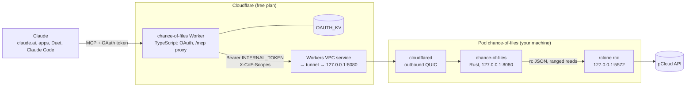

# Chance of Files

*Cloudy, with a chance of files:* your pCloud, raining down into Claude's context.

Let **Claude** read the files in your **pCloud**: text and images, from claude.ai, the Claude apps, Claude Code and **Claude Duet**, through a custom connector you host yourself.

pCloud has an [official MCP server](https://mcp.pcloud.com/mcp), and it's good at organizing files, but none of its tools return what's inside one. Chance of Files fills that gap: Claude can list, search and read text files and images anywhere in your drive, except the folders you hide. It's read-only in 0.2; writes, a whole-drive index and download links are on the [roadmap](docs/roadmap.md).

It has two halves:

- **The core**, a Rust server (`chance-of-files`) that runs next to `rclone rcd` and `cloudflared` in one pod on any Kubernetes or k3s node you have (a NAS, a mini PC, a Raspberry Pi 5), or as three containers on a plain Docker host. rclone talks to pCloud's API with its own registered app, so no pCloud Drive mount and no laptop are involved.
- **The auth Worker**, a small TypeScript Worker on Cloudflare's **free** plan. It's the URL you add to Claude; it handles OAuth and forwards requests to the core through a Workers VPC service and a Cloudflare Tunnel that has no public hostname. Nothing on your network listens to the internet.

Chance of Files is an independent, self-hosted project. It is not affiliated with, endorsed by or supported by pCloud or Anthropic; "pCloud" and "Claude" are their owners' trademarks, used here only to say what this works with.

## Status

**0.2 (in progress), October 2026.** The core moved off Cloudflare Workers onto your own machine ([design](docs/design/v2.md)); the five read tools are the same as in 0.1. pCloud removed password sign-in from its API in April 2026 and approves OAuth apps by hand; this project's request is pending, so the core reaches pCloud through rclone's remote-control API with an rclone `pcloud` remote you authorise once.

**0.1 (Workers only)** ran the core as a second Worker and read pCloud through the pCloud Drive mount on a laptop. It's frozen at tag [`v0.1.0`](https://github.com/tywrr/chance-of-files/tree/v0.1.0); its README and setup guide are there.

## Chance of Files or pCloud's own MCP server?

| | [pCloud MCP](https://mcp.pcloud.com/mcp) (official) | Chance of Files 0.2 |
|---|---|---|
| Hosted by | pCloud | You: a pod on your own machine, plus a free Cloudflare Worker |
| List folders, search names, file info | Yes | Yes |
| Read text files | No | Yes, up to 100 kB per call, with offsets for longer files |
| Read images | No | Yes, up to 1.5 MiB by default |
| Create, copy, move, rename, upload, public links | Yes | Not yet (0.4, behind a separate `files:write` consent) |
| Delete | No | Not yet (0.4, to pCloud's trash only) |
| What Claude can reach | Your whole account | Your whole drive minus the paths you hide |

They don't conflict. Add both, and Claude organizes with pCloud's and reads with this one; the paths match.

## Tools

| Tool | Arguments | What Claude gets |
|---|---|---|
| `list_folder` | `path` (default `/`) | The folder's files and subfolders, with sizes and modified times |
| `get_file_info` | `path` | Name, type, size, modified time and content type of one file or folder |
| `read_text_file` | `path`, `offset` (default 0), `max_bytes` | Text from `offset`, at most `limits.max_read_bytes` (100,000) bytes per call; Claude calls again with a later offset to read on |
| `read_image` | `path` | The image itself (PNG, JPEG, GIF or WebP), if it's at most `limits.max_image_bytes` (1.5 MiB) |
| `search_files` | `query`, `path` (default `/`), `limit` | Files and folders under `path` whose **name** contains `query`, ignoring case and accents. It goes around the folders in `policy.search_skip` |

All five need only the `files:read` scope, which every sign-in grants. An `/AGENTS.md` at the root of your drive, if you write one, goes into the instructions Claude gets when it connects: say there what each folder is for.

## How it works



1. Claude calls `https://chance-of-files.<your-subdomain>.workers.dev/mcp` with an OAuth access token. The auth Worker checks it, replaces it with the internal token, adds the grant's scopes as `X-CoF-Scopes`, and forwards the request over its VPC service binding.
2. The binding reaches the pod through a Cloudflare Tunnel; cloudflared hands the request to the core on loopback.
3. The core checks the internal token, applies your path policy (hidden folders never reach rclone), runs the tool and calls rclone's remote-control API, which calls pCloud.

[docs/architecture.md](docs/architecture.md) has the details and the reasons.

## Security model

- **Only you can connect.** The sign-in page asks for a passphrase only you know; there are no accounts. Attempts are rate limited, Claude gets tokens for this server's `/mcp` only, refresh tokens rotate, and the KV store keeps only token hashes.
- **Read and write are separate grants.** Every sign-in gets `files:read`; `files:write` only when you tick an unticked-by-default box on the consent page. 0.2 has no write tools, but the core already filters `tools/list` by scope and refuses calls whose scope is missing.
- **Nothing listens on your network.** cloudflared dials out; the tunnel has no public hostname and is reachable only from Workers bound to its VPC service. The core and rclone listen on the pod's loopback, a NetworkPolicy denies all ingress, and the pod runs under the `restricted` Pod Security profile (non-root, read-only root filesystem, no capabilities, no service-account token, no hostPath).
- **Hidden paths are enforced in one place.** The core's `policy.hidden` list is checked on normalized paths before any rclone call; rclone itself runs with no filters (they don't stop single-object calls, and they'd slow listings down; see [phase 0](docs/design/phase0-rclone.md)). Hide your Crypto Folder and anything else Claude shouldn't see.
- **The internal token is the core's only door.** The core refuses every `/mcp` request without it (constant-time compare) and trusts `X-CoF-Scopes` only on requests that carry it. rclone's rc password never leaves the pod.

What it doesn't protect against:

- **Anything not hidden can reach Claude.** Hide IDs, tax papers and password exports, or keep them outside pCloud.
- **File contents are untrusted input.** A file can contain instructions aimed at Claude (prompt injection). Read-only tools limit what that can do.
- **Cloudflare and Anthropic see the traffic.** TLS ends at Cloudflare's edge, as with any Worker, and tool results pass through Anthropic, as with any connector.

## Limitations

- **A machine that runs containers, always on.** A single-node k3s on a NAS is the reference setup; any Kubernetes works, and so does Docker (see [setup](docs/setup.md#running-on-plain-docker)). At rest the pod uses roughly 150 MB of RAM (rclone idles at about 85 MB).
- **Workers VPC is free while it's in beta.** If that changes, the fallback is a tunnel public hostname behind Cloudflare Access ([design, Risks](docs/design/v2.md#risks)).
- **Claude's limits:** a tool result is capped at about 150,000 characters (reads are paged) and a call at 240 seconds; the core stops at 180 s (`server.deadline`).
- **Claude Duet is a research preview.** It uses your claude.ai connectors when you talk to it; its scheduled and background runs may skip custom connectors.
- **claude.ai sometimes doesn't finish adding a custom connector, or hides its tools** even when it shows Connected ([anthropics/claude-ai-mcp#831](https://github.com/anthropics/claude-ai-mcp/issues/831), [#476](https://github.com/anthropics/claude-ai-mcp/issues/476)). See [troubleshooting](docs/setup.md#troubleshooting).
- **Text and images only, names only.** PDFs, Office files, mail and full-text search come in 0.5.

## Documentation

| Doc | Read it for |
|---|---|
| [Setup](docs/setup.md) | Running your own: the rclone remote, the tunnel and VPC service, the image, the pod, the auth Worker, the connector in Claude |
| [Development](docs/development.md) | The local loop, tests, building images, Claude Code and MCP Inspector |
| [Architecture](docs/architecture.md) | Components, request flow, auth layers and scopes, the config file, limits |
| [Roadmap](docs/roadmap.md) | Index and audit tools, writes and links, mirror and full text, the pCloud API backend |
| [Design v2](docs/design/v2.md) | The full v2 design and the phase 0 measurements behind it |
| [Background](docs/background.md) | Why this exists, prior art, pCloud API gotchas (written for 0.1) |

## Development

```bash
mise install          # node, wrangler, rclone (Rust comes from rustup)
mise run dev          # rclone rcd over fixtures/webdav-root + the server on http://127.0.0.1:8080/mcp
mise run smoke        # another terminal: tools/list and every tool through the MCP Inspector CLI
mise run test         # cargo test --workspace and the auth front's tests
mise run lint         # fmt, clippy -D warnings, typecheck, shellcheck, kustomize render
mise run build-image  # static musl binaries -> OCI archives in target/oci
```

| Path | What |
|---|---|
| `crates/core` | The MCP endpoint, JSON-RPC, tools, `Storage` trait, policy and scopes. No I/O of its own |
| `crates/rclone` | `Storage` over rclone's remote-control API |
| `crates/webdav` | `Storage` over WebDAV, for a local folder or NAS |
| `crates/server` | The `chance-of-files` binary: axum, config, `/mcp`, `/healthz`, `/readyz` |
| `auth/` | The TypeScript Worker `chance-of-files`: OAuth and the `/mcp` proxy |
| `deploy/` | Kustomize base (`k8s/base`), `k8s/apply.sh`, `build-image.sh`, `oci-image.py`, `dev.sh` |
| `config.example.toml` | Every config option, documented |

## License

Chance of Files is an independent project, not affiliated with pCloud or Anthropic.

Licensed under either of [Apache License 2.0](LICENSE-APACHE) or [MIT](LICENSE-MIT), at your option.
