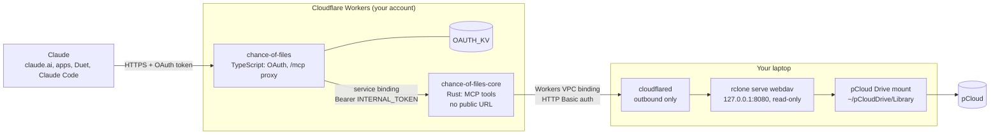

# Chance of Files

*Cloudy, with a chance of files:* your pCloud, raining down into Claude's context.

Let **Claude** read the files in your **pCloud**: text and images, from claude.ai, the Claude apps, Claude Code and **Claude Duet**, through a custom connector you host yourself.

pCloud has an [official MCP server](https://mcp.pcloud.com/mcp), and it's good at organizing files, but none of its tools return what's inside one. Chance of Files fills that gap: Claude can list, search and read text files and images in one pCloud folder you choose, or the whole drive. It's read-only for now.

It's a remote MCP server on Cloudflare Workers: a Rust Worker with the tools, behind a small TypeScript Worker that handles OAuth. The free plan runs it for a focused folder of up to about a thousand files; see [limitations](#limitations). You add it in claude.ai like any other connector and approve it with a passphrase only you know. Claude Duet uses the connectors on your claude.ai account, so Duet gets it too.

Chance of Files is an independent, self-hosted project. It is not affiliated with, endorsed by or supported by pCloud or Anthropic; "pCloud" and "Claude" are their owners' trademarks, used here only to say what this works with.

## Status

**Proof of concept**, October 2026. pCloud removed password sign-in from its API in April 2026, and an OAuth app has to be approved by pCloud by hand; this project's request is pending. Until then, Chance of Files reads pCloud the long way round, through the [pCloud Drive](https://www.pcloud.com/download-free-online-cloud-file-storage.html) mount on your laptop:

Claude → two Workers → Cloudflare Tunnel → your laptop → `rclone serve webdav --read-only` → `~/pCloudDrive/<folder>` → pCloud

So the laptop has to be on, awake and running pCloud Drive. A backend that calls the pCloud API directly, with no laptop involved, comes once an app is approved; the tools are written against a storage trait so it drops in. See the [roadmap](docs/roadmap.md).

## Chance of Files or pCloud's own MCP server?

| | [pCloud MCP](https://mcp.pcloud.com/mcp) (official) | Chance of Files |
|---|---|---|
| Hosted by | pCloud | You: two Workers on your Cloudflare account, plus your laptop for now |
| List folders, search names, file info | Yes | Yes |
| Read text files | No | Yes, up to 100 kB per call, with offsets for longer files |
| Read images | No | Yes, up to 1.5 MiB by default |
| Create, copy, move, rename, upload, public links | Yes | No (read-only for now) |
| Delete | No | No |
| What Claude can reach | Your whole account | One folder you choose, or the whole drive minus what you filter out |
| Works with your laptop off | Yes | Not yet |

They don't conflict. Add both, and Claude organizes with pCloud's and reads with this one. Serve the whole drive and the paths match too, so Claude can find a file with one and read it with the other.

## Tools

| Tool | Arguments | What Claude gets |
|---|---|---|
| `list_folder` | `path` (default `/`) | The folder's files and subfolders, with sizes and modified times |
| `get_file_info` | `path` | Name, type, size, modified time and content type of one file or folder |
| `read_text_file` | `path`, `offset` (default 0), `max_bytes` | Text from `offset`, at most `MAX_READ_BYTES` (100,000) bytes per call; Claude calls again with a later offset to read on |
| `read_image` | `path` | The image itself (PNG, JPEG, GIF or WebP), if it's at most `MAX_IMAGE_BYTES` (1.5 MiB) |
| `search_files` | `query`, `path` (default `/`), `limit` | Files and folders under `path` whose **name** contains `query`, ignoring case and accents, at most `SEARCH_LIMIT` (50). It goes around folders you turn off with `SEARCH_SKIP` |

Paths are relative to the folder you serve: `/` is its root, and `..` is rejected. An `AGENTS.md` at that root, if you write one, goes into the instructions Claude gets when it connects: say there what each folder is for ([setup](docs/setup.md#serving-the-whole-drive)).

## How it works



1. Claude calls `https://chance-of-files.<your-subdomain>.workers.dev/mcp` with an OAuth access token. The auth Worker checks it, swaps it for the internal token and forwards the request over a service binding.
2. The core Worker answers MCP (Streamable HTTP, stateless JSON-RPC) and runs the tool, which reads through the `Storage` trait: here WebDAV `PROPFIND` and ranged `GET`.
3. Those requests reach your laptop through a Workers VPC binding and a Cloudflare Tunnel that has no public hostname. rclone serves the folder read-only, and pCloud Drive fetches file contents from pCloud on demand.

[docs/architecture.md](docs/architecture.md) has the details and the reasons.

## Security model

- **Only you can connect.** The sign-in page asks for `OWNER_PASSPHRASE`, 32 random characters if you follow the setup; there are no accounts. The passphrase is the defence: attempts are rate limited per address (per `/64` for IPv6), which slows guessing from one place but not from many. Claude gets tokens for this server's `/mcp` only, refresh tokens rotate, and the KV store keeps only token hashes.
- **Strangers can't write much.** Showing the sign-in page writes nothing, and neither does a wrong passphrase. Dynamic Client Registration (`POST /register`) is accepted only from `DCR_ALLOWED_CIDRS`: by default only loopback, for local development. Claude and Claude Code identify themselves with a Client ID Metadata Document instead and don't register at all; a client that registers instead, such as the MCP Inspector, needs `DCR_ALLOWED_CIDRS="*"` for the minute it takes them to register ([setup](docs/setup.md#11-add-the-connector-in-claude)).
- **The core Worker has no public URL** (`workers_dev = false`). Only the auth Worker can call it, over the service binding, and it still checks `INTERNAL_TOKEN` (constant-time) on every request. Claude's tokens never reach it.
- **Your laptop opens no ports.** cloudflared connects out, the tunnel has no public hostname, and only Workers bound to its VPC service can send requests through it. rclone listens on `127.0.0.1` only, requires Basic auth, serves one folder, and is read-only.
- **Read-only twice over.** No tool writes, and rclone would refuse if one tried.

What it doesn't protect against:

- **Anything in the served folder can reach Claude.** Don't serve folders with IDs, tax papers or password exports. When you serve the whole drive, hide them with rclone's filter file, and hide the Crypto Folder too: it's unreadable while locked, but pCloud Drive shows it in plain text whenever it's unlocked.
- **File contents are untrusted input.** A file can contain instructions aimed at Claude (prompt injection). Read-only tools limit what that can do.
- **Cloudflare and Anthropic see the traffic.** TLS ends at Cloudflare's edge, as with any Worker, and tool results pass through Anthropic, as with any connector.

## Limitations

- **Your laptop must be on, awake, online and running pCloud Drive.** While it sleeps, tools fail with a backend error.
- **The Workers free plan allows 10 ms of CPU per request.** Waiting on the laptop doesn't count, but parsing listings and encoding images does. On the free plan, `search_files` stays under it up to roughly 1,000 entries under the path it searches (the whole served folder by default), `list_folder` up to roughly 1,000 to 1,500 entries in one folder, and `read_image` up to about 1.5 MiB, the default `MAX_IMAGE_BYTES`. A listing bigger than `MAX_LISTING_BYTES` (400,000 bytes) fails cleanly, as a tool error that tells Claude to narrow the path, instead of running out of CPU. So serve a focused folder, or serve the whole drive and list its huge folders (a photo backup, say) in `SEARCH_SKIP`: searches then go around them, and Claude browses them with `list_folder` ([Serving the whole drive](docs/setup.md#serving-the-whole-drive)). [Workers Paid](https://developers.cloudflare.com/workers/platform/pricing/) ($5 a month, 30 s of CPU per request) lifts this; raise `MAX_LISTING_BYTES` and `MAX_IMAGE_BYTES` there. The free plan's other limits (128 MB memory, 50 subrequests per request, 100,000 requests and 1,000 KV writes a day) are plenty for one person.
- **Claude's limits:** a tool result is capped at about 150,000 characters (which is why reads are paged) and a call at 240 seconds.
- **Claude Duet is a research preview** (US Pro and Max, since 2026-10-21). It uses your claude.ai connectors when you talk to it; its scheduled and background runs may skip custom connectors.
- **claude.ai sometimes doesn't finish adding a custom connector, or hides its tools** even when it shows Connected ([anthropics/claude-ai-mcp#831](https://github.com/anthropics/claude-ai-mcp/issues/831), [#476](https://github.com/anthropics/claude-ai-mcp/issues/476)). The desktop and mobile apps and Claude Code usually work when the web doesn't; see [troubleshooting](docs/setup.md#sign-in-succeeds-but-the-card-stays-on-connect-or-the-tools-never-appear).
- **Text and images only, names only.** PDFs and Office files come later, and search matches names, not contents.

## Documentation

| Doc | Read it for |
|---|---|
| [Setup](docs/setup.md) | Running your own: rclone and cloudflared on the laptop, the tunnel, both Workers, the connector in Claude, troubleshooting |
| [Development](docs/development.md) | The local loop, tests, Claude Code and MCP Inspector, a separate dev deployment |
| [Architecture](docs/architecture.md) | Components, request flow, the auth layers, limits, why Rust plus TypeScript |
| [Background](docs/background.md) | Why this exists, prior art, pCloud API gotchas, alternatives considered |
| [Roadmap](docs/roadmap.md) | pCloud API backend, write tools, more file types |

## Development

```bash
mise install                                                 # node 26 and wrangler, pinned
cp crates/worker/.dev.vars.example crates/worker/.dev.vars
mise run backend      # terminal 1: rclone serves fixtures/webdav-root on 127.0.0.1:8081
mise run dev          # terminal 2: the core Worker on http://127.0.0.1:8787/mcp
mise run smoke        # terminal 3: tools/list and every tool through the MCP Inspector CLI
mise run test         # cargo test --workspace and the auth front's tests
```

Rust comes from rustup with the `wasm32-unknown-unknown` target, plus `cargo install worker-build@0.8.7`. [docs/development.md](docs/development.md) has the rest.

| Path | What |
|---|---|
| `crates/core` | `chance-of-files-core`: the MCP endpoint, JSON-RPC and tools over the `Storage` trait; no Workers or WebDAV code, so it tests natively |
| `crates/webdav` | `chance-of-files-webdav`: `Storage` over WebDAV (rclone) |
| `crates/worker` | `chance-of-files-worker`: the Rust Worker, deployed as `chance-of-files-core` |
| `auth/` | The TypeScript Worker `chance-of-files`: OAuth and the `/mcp` proxy |
| `scripts/`, `fixtures/` | Local WebDAV backend, smoke test, sample file tree |
| `deploy/systemd/` | User services for rclone and cloudflared |

## License

Chance of Files is an independent project, not affiliated with pCloud or Anthropic.

Licensed under either of [Apache License 2.0](LICENSE-APACHE) or [MIT](LICENSE-MIT), at your option.
