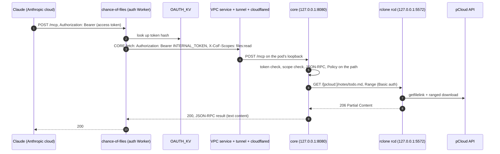

# Architecture

How Chance of Files 0.3 is put together, and why. For running it, see [setup.md](setup.md); for working on it, [development.md](development.md). The full design, with what comes after 0.3, is [design/v2.md](design/v2.md).

## Components

| Component | Runs on | Code | Job |
|---|---|---|---|
| `chance-of-files` (auth Worker) | Cloudflare Workers, free plan, public | `auth/`, TypeScript, [`@cloudflare/workers-oauth-provider`](https://github.com/cloudflare/workers-oauth-provider) | OAuth 2.1 authorization server (PKCE, Client ID Metadata Documents, Dynamic Client Registration) and protected resource for `/mcp`; forwards authorized requests to the core with the internal token and the grant's scopes |
| `OAUTH_KV` | Workers KV | | OAuth clients, grants and token hashes |
| Workers VPC service + Cloudflare Tunnel | Cloudflare | | A private path from the auth Worker's `CORE` binding to `127.0.0.1:8080` in the pod; the tunnel has no public hostname |
| `cloudflared` | The pod | `cloudflare/cloudflared` image | The tunnel's connector; dials out over QUIC |
| `chance-of-files` (the core) | The pod | `crates/server` (binary), `crates/core`, `crates/rclone`, `crates/index` | MCP over Streamable HTTP (stateless), the tools, path policy, scopes; the index walks and the health check in the background; `/healthz` and `/readyz` |
| `rclone rcd` | The pod | `rclone/rclone` image | rclone's remote-control API on loopback: listings, stat, ranged reads (`--rc-serve`) against the remote `pcloud` |
| PVC `chance-of-files-data` | The node's disk | | `/var/lib/chance-of-files`: `index/index.db` from 0.3; link and job state, the mirror and upload staging from later releases |

| Crate | What |
|---|---|
| `chance-of-files-core` (`crates/core`) | The MCP endpoint, JSON-RPC dispatch, the tools, the `Storage` trait, `Policy` and scopes. No I/O of its own; tests run against an in-memory store |
| `crates/rclone` | `Storage` over rclone's rc API (`operations/list`, `operations/stat`, `--rc-serve` for ranged reads, `operations/about` for health) |
| `chance-of-files-webdav` (`crates/webdav`) | `Storage` over WebDAV, for serving a local folder or a NAS instead of pCloud |
| `crates/index` | The metadata index: SQLite (rusqlite, bundled, WAL), split walks, walk guards, folder totals, duplicate hashing, the audit queries |
| `crates/server` | The `chance-of-files` binary: axum on tokio, config file, internal-token check, routes, the walk scheduler and health check |

## Request flow

A `read_text_file` call from claude.ai, once the connector is signed in:

Before that, the connector signs in once:

1. Claude probes `/.well-known/oauth-authorization-server` and the protected-resource metadata (`/.well-known/oauth-protected-resource/mcp`). An unauthenticated `POST /mcp` gets `401` with `WWW-Authenticate: Bearer resource_metadata="…"`.
2. Claude identifies itself with its Client ID Metadata Document, or registers with `/register` (DCR), which accepts only addresses in `DCR_ALLOWED_CIDRS` (loopback by default).
3. Your browser opens `/authorize`, a consent page that asks for the owner passphrase, with an unticked box for `files:write`. On success it redirects back to Claude with a code.
4. Claude exchanges the code at `/token` (PKCE S256) for an access token and a refresh token, then sends `initialize` and `tools/list`.

## Auth layers and scopes

Each hop has its own credential, so a leak at one layer doesn't open the others.

| Hop | Who can call | Credential | Where it's checked |
|---|---|---|---|
| Internet → auth Worker | Anyone can reach it; only you can sign in | OAuth access token for `<public URL>/mcp`, issued after the passphrase | `workers-oauth-provider` in `auth/` |
| Auth Worker → core | Only Workers bound to the VPC service | VPC binding (the tunnel has no public hostname), then `INTERNAL_TOKEN` | Cloudflare, then the core (constant-time compare; otherwise `401`) |
| Core → rclone | Processes in the pod (loopback only) | rc Basic auth, user `core`, `RC_PASS` | rclone |
| rclone → pCloud | | rclone's OAuth token for its own registered pCloud app | pCloud |

**Scopes.** The auth Worker offers `files:read` (always granted) and `files:write` (only if the owner ticks the box, whatever the client asked for). It strips any `X-CoF-*` header a client sent and adds `X-CoF-Scopes` (space-separated) after it has replaced `Authorization` with the internal token. The core trusts `X-CoF-Scopes` only on requests that carry a valid internal token; a request without the header gets `files:read` only. `tools/list` lists only the tools the request's scopes allow, and a call to any other tool fails with an authorization error. In 0.2 every tool needs `files:read`, so this changes nothing visible yet; the write tools of 0.4 need `files:write`. To change a grant, reconnect the connector.

**Why each layer:**

- **OAuth at the front** is what Claude's custom connectors speak, and Duet uses the same connectors as claude.ai.
- **Workers VPC instead of a public tunnel hostname:** with a VPC service the tunnel is reachable only from Workers you bind to it. Nothing about the core is on the public internet.
- **`INTERNAL_TOKEN`** keeps Claude's access tokens at the front, and means the core refuses everything if the binding were ever misconfigured.
- **rclone's rc password** is root-equivalent inside the rclone container (`--rc-serve` also serves local paths), so it stays in the pod, on loopback, and the core builds rc-serve URLs only from the configured remote name and a policy-checked path.

## The core

### Why a native core

0.1 ran the core as a Rust Worker, which meant 10 ms of CPU per request, 50 subrequests and 128 MB of memory, and reading pCloud through a laptop's pCloud Drive mount. 0.2 runs the same tool code natively on tokio and axum, next to rclone, so listings of tens of thousands of entries, long reads and (later) a whole-drive index are cheap, and the laptop is out of the path. The OAuth front stays a Worker because it needs a public HTTPS endpoint and workers-oauth-provider, and the free plan is enough for it.

### Why stateless MCP

The endpoint is Streamable HTTP in stateless mode: every `POST /mcp` carries one JSON-RPC message and gets a plain JSON response, and there is no `Mcp-Session-Id`. Every tool is a read with no per-client state between calls; paging uses explicit offsets or opaque cursors that carry everything the next page needs. MCP 2025-11-25 makes sessions optional, Claude's connector client doesn't rely on them, and MCP 2026-07-28 moves further toward stateless requests. So `GET /mcp` and `DELETE /mcp` answer `405`, and notifications get `202`. `initialize` negotiates `2025-03-26`, `2025-06-18` and `2025-11-25`; `2026-07-28` clients put their version in each request's `_meta`. The dispatch is hand-written over [rmcp](https://crates.io/crates/rmcp)'s `model` types (design decision D1): rmcp's server runtime would bring sessions and SSE that buy nothing here.

### Routes

| Route | Auth | Answer |
|---|---|---|
| `POST /mcp` | `Authorization: Bearer <INTERNAL_TOKEN>` | MCP; `X-CoF-Scopes` decides which tools exist |
| `GET /healthz` | none | `200` while the process runs |
| `GET /readyz` | none | `200` when rclone answers `operations/about`, else `503`; no details either way |

The core listens on `127.0.0.1:8080` only. Health routes are for `kubectl port-forward` and local checks; nothing outside the pod can reach them.

### Storage and policy

The tools see only the `Storage` trait; `crates/rclone` implements it over rclone's rc API, and `crates/webdav` over WebDAV. Paths are normalized (absolute, no `.` or `..`, no control characters, NFC, case-folded for matching) and checked against `Policy` before a backend sees them:

| Rule | Effect |
|---|---|
| `policy.hidden` | Never listed, searched or read; errors say "not found" |
| `policy.protected` | Visible and readable; any write touching it is refused (from 0.4) |
| `policy.search_skip` | `search_files` leaves these folders out of its results; Claude can still list, read and audit them |

**rclone runs with no filters at all.** Phase 0 measured that any directory filter makes rclone drop pCloud's recursive listing (a 133k-entry folder: 6 s became 133 s) and turn folder moves into per-file moves, and that filters don't affect single-object calls (`stat`, `copyfile`, `deletefile`, rc-serve `GET`) anyway ([phase0-rclone.md](design/phase0-rclone.md)). So `Policy` in the core is the only enforcement point, and the rclone client accepts only paths that `Policy` produced.

`initialize` also reads the first 8 KiB of the owner's guide (`guide.path`, `/AGENTS.md` by default) and appends it to the instructions. Any error leaves it out.

## The index

From 0.3 the core keeps a metadata index of the drive, so listings, name searches and audit questions don't walk pCloud each time. It's a cache: everything in it can be rebuilt from pCloud, and deleting `index.db` only costs a first walk. (Design decision D3: one engine, SQLite, for this and for the full-text index of 0.5.)

**What's in `index.db`.** One row per file and folder (path, parent, name and a case- and accent-folded copy of it, size, modified time, extension, kind, pCloud ID, root, walk generation), plus:

| Table | Holds |
|---|---|
| `entries` | Every visible file and folder, with `own_write_at` and `deleted_at` columns the write tools of 0.4 will use to keep a walk from undoing them |
| `folder_totals` | Per folder: files, subfolders, bytes and newest modified time, over everything below it, across roots |
| `hashes` | SHA-1 and MD5 for files that took part in a duplicate check, keyed by pCloud ID and kept while size and modified time match |
| `changes` | Adds, size/mtime changes, moves (same pCloud ID, new path) and removals, as each walk applies them; `recent_changes` reads it |
| `roots` | Per root: interval, when the last walk started and finished, its error, generation, entry count, held removals |

Links, jobs and the audit log of own writes go into a separate `state.db` in 0.4, because unlike the index they can't be rebuilt; the full-text index of 0.5 is `text.db`.

**Roots and split walks.** `[index] roots` lists the folders walked on their own schedule; `/` is the default, and a huge, slow-changing tree such as a photo backup is worth its own root with a longer interval. Roots never overlap: a parent root's walk leaves out every child root and every `policy.hidden` path by **splitting the tree**, not by filtering. Each ancestor of an excluded path is listed on its own (non-recursively), and every sibling subtree is listed recursively in one `operations/list` call with no filter. For a drive with `/Backups/Immich` as a child root and `/Crypto Folder` hidden, walking `/` is about a dozen API calls and ~4 s at `--tpslimit=8`; rclone filters would have made it 716 calls and 90 s, and they'd still have fetched the hidden folder ([phase 0](design/phase0-rclone.md)). So hidden folders are never fetched, not even their names, and each entry belongs to exactly one root; the folder entry of a child root comes from its parent's walk. `folder_totals` adds up all roots, so `/`'s totals include the photo backup; result headers show each contributing root's own "as of".

**Parsing big listings.** A recursive listing of a 133k-file folder is one ~35 MB JSON answer from rclone. The core parses it as a stream, entry by entry, into the walk's diff, instead of holding the whole document and a tree of values in memory; `limits.max_listing_bytes` caps how much it reads.

**Walk guards.** Walks run one at a time, each root on its interval (30 min by default) and on `refresh_index`.

- A walk records `walk_started` before it lists, and a failed walk changes nothing but `last_error`; the previous generation keeps answering.
- Applying a walk: new entries are added, changed and moved ones updated (a move is the same pCloud ID at a new path), and rows the listing didn't contain are removed, each as a `changes` row. Two exceptions keep a walk from undoing the core's own writes (from 0.4): rows written by the core at or after `walk_started` stay as written, and tombstones of the core's own deletes made at or after `walk_started` aren't re-added (times are whole seconds, so a tie goes to the core's own write). Tombstones go once a walk that started after them completes.
- A walk that never finished (the core stopped mid-walk) counts as failed at the next start: that root is walked again after the first back-off (2 minutes), not a whole interval later.
- **Mass-removal hold.** A walk that would remove more than `max_removal` (5%) of a root's entries applies its adds and changes but holds the removals. `index_status` shows what's held ("walk of / at 14:05Z would remove 7,412 entries (6.1%)") and `refresh_index path=/ confirm=true` applies it. A flaky or truncated listing can't empty the index, or, in 0.5, the mirror through it. Any later walk, a subtree walk included, releases the held rows it sees again (and the folder it walked, and that folder's ancestors) and recounts what's still held; confirming also skips entries seen or written since the hold.

**Duplicates.** pCloud listings carry no hashes, and each hash is one API call (`operations/stat` with `showHash`, 0.2–0.7 s). So `find_duplicates` groups by size in SQL first and hashes only files in a size collision of at least `min_size` (1 MiB by default), using the hash the backend reports in `operations/fsinfo` (SHA-1 and MD5 on pCloud US). Hashes are cached in `hashes` while size and modified time match, and filled lazily, a few at a time under rclone's `--tpslimit`; a result says when some groups are still matched by size only.

**Health check.** `operations/about` (0.16 s) every 5 minutes and after any rclone error. While it fails, index tools keep answering with their "as of" and every result header adds `backend unhealthy since 13:40Z: <error>`; live calls (`get_file_info`, reads, `list_folder live=true`) fail fast with the same message, and walks pause with backoff. `index_status` shows it too.

**What answers from where.**

| Tool | Source |
|---|---|
| `list_folder` | The index, sortable and paged; `live=true` → `operations/list` through rclone |
| `get_file_info` | Live `operations/stat` (hash with `hash=true`), plus folder totals from the index |
| `read_text_file`, `read_image` | rclone, live (the mirror of 0.5 will serve fresh copies) |
| `search_files` | The index: folded name match over the whole drive (minus `search_skip`) |
| `folder_stats`, `query_files`, `type_breakdown`, `recent_changes` | SQL over `entries`, `folder_totals` and `changes` |
| `find_duplicates` | SQL by size, then cached or freshly fetched hashes |
| `index_status`, `refresh_index` | The `roots` table, the health check; `refresh_index` queues a walk and returns at once |

Every index tool returns a header line, for example `[rows 1-500 of 13,204 · / as of 14:05Z, /Backups/Immich as of 09:00Z · next cursor=…]`, keeps its result under 120,000 characters, and pages with an opaque cursor that encodes the last row's sort key and the index generation. Audit tools also return `structuredContent`. Hidden paths are never in the index, so they can't appear in a result; `policy.protected` only matters for writes.

## Configuration

One TOML file, from `--config`, else `CHANCE_OF_FILES_CONFIG`, else `/etc/chance-of-files/config.toml`. Secrets come only from the environment: `INTERNAL_TOKEN` and `RC_PASS`. Every option is documented in [`config.example.toml`](../config.example.toml); the cluster's copy is [`deploy/k8s/base/config.toml`](../deploy/k8s/base/config.toml).

| Section | Keys |
|---|---|
| `[server]` | `listen` (`127.0.0.1:8080`), `deadline` (`180s`), `allowed_origins`, `state_dir` (unset; the base sets `/var/lib/chance-of-files`) |
| `[rclone]` | `url` (`http://127.0.0.1:5572`), `user` (`core`), `remote` (`pcloud`), `health_every` (`5m`) |
| `[policy]` | `hidden`, `protected`, `search_skip` |
| `[index]` | `enabled` (`true`), `dir` (`<server.state_dir>/index`, where `index.db` lives), `max_removal` (`0.05`), `hash_min_size` (`1048576`), `hash_in_background` (`true`), `roots` (`[{ path = "/", every = "30m" }]`) |
| `[guide]` | `path` (`/AGENTS.md`) |
| `[limits]` | `max_read_bytes`, `max_image_bytes`, `max_listing_bytes` |

The index is off unless it has somewhere to live: `[index].dir`, or `[server].state_dir` (it then uses `<state_dir>/index`). With neither set (the built-in defaults) the server runs as 0.2 did, every tool asking rclone directly and no audit tools, and logs a warning at startup; `enabled = false` turns it off on purpose.

## The pod

`deploy/k8s/base` is a kustomize base: Namespace `chance-of-files` (Pod Security `restricted`), Deployment `chance-of-files` (one replica, `Recreate`, three containers), the ConfigMap generated from `config.toml`, PVC `chance-of-files-data`, and a NetworkPolicy that denies all ingress and allows egress only to DNS, 443 and 7844. The Secret `chance-of-files` (`internal-token`, `rc-pass`, `pcloud-token`, `pcloud-hostname`, `tunnel-token`) is created by `deploy/k8s/apply.sh` from local files and is never in git.

- **One replica, `Recreate`:** Cloudflare spreads requests across every connector of a tunnel, so two pods would split traffic.
- **No probes:** the kubelet's HTTP probes go to the pod IP, and nothing listens there; exec probes need a shell the images don't have; and readiness would gate nothing, since no Service selects the pod. `apply.sh` checks `/readyz` through `kubectl port-forward` after each rollout instead.
- **The image** is the static musl binary alone (`deploy/build-image.sh`, no Docker needed). rclone and cloudflared stay on their pinned upstream images, so their upgrades are independent.

## Limits

| Limit | Value | Set by |
|---|---|---|
| Text per `read_text_file` call | 100,000 bytes (`limits.max_read_bytes`) | This project, under Claude's ~150,000-character cap on a tool result |
| Image size for `read_image` | 1.5 MiB (`limits.max_image_bytes`) | This project; base64 makes it a third larger in the result |
| One rclone listing the core parses | 64 MB (`limits.max_listing_bytes`) | This project; a recursive listing of 133k entries is ~35 MB, parsed as a stream |
| Characters per tool result | 120,000, then a cursor | This project, under Claude's ~150,000-character cap |
| Index freshness | One walk per root per `every` (30 min by default) | This project; rclone's pCloud app has no change feed |
| Mass removal held for confirmation | More than 5% of a root's entries (`index.max_removal`) | This project |
| Time per tool call | 180 s (`server.deadline`); Claude allows 240 s | 200 s measured to pass end to end ([phase0-network.md](design/phase0-network.md)) |
| pCloud API calls | 8 per second (`--tpslimit=8`) | This project, to stay well inside pCloud's limits |
| Request body through Cloudflare | 100 MB | Cloudflare (matters for uploads, from 0.4) |
| Workers requests / KV writes | 100,000 / 1,000 a day | Workers free plan; only sign-ins and token refreshes write KV |
| Metadata cache | about 5 minutes | Claude caches the server's metadata and tool list |

## Why a TypeScript auth front

OAuth is TypeScript because [`@cloudflare/workers-oauth-provider`](https://github.com/cloudflare/workers-oauth-provider) already implements what Claude needs and keeps up with the MCP authorization spec: RFC 8414 and RFC 9728 metadata, DCR, CIMD (with SSRF-safe fetching), PKCE, refresh-token rotation, and hashed tokens in KV. Writing that in Rust would mean owning security-sensitive code with no maintained equivalent. See [background.md](background.md#alternatives-considered).
