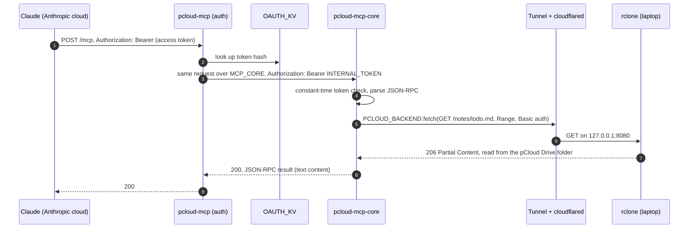

# Architecture

How pcloud-mcp is put together, and why. For running it, see [setup.md](setup.md); for working on it, [development.md](development.md).

## Components

| Component | Runs on | Code | Job |
|---|---|---|---|
| `pcloud-mcp` (auth front) | Cloudflare Worker, public | `auth/`, TypeScript, [`@cloudflare/workers-oauth-provider`](https://github.com/cloudflare/workers-oauth-provider) 1.2.4 | OAuth 2.1 authorization server (PKCE, Client ID Metadata Documents, Dynamic Client Registration) and protected resource for `/mcp`; forwards authorized requests to the core |
| `pcloud-mcp-core` (core) | Cloudflare Worker, no public URL | `crates/worker`, Rust, [workers-rs](https://github.com/cloudflare/workers-rs) 0.8.7 | Checks `INTERNAL_TOKEN`, reads its config, builds the WebDAV storage and hands the request to the MCP server |
| `pcloud-mcp-core` crate | (library) | `crates/core` | MCP Streamable HTTP endpoint, JSON-RPC dispatch, the five tools, the `Storage` trait. No Workers or WebDAV code |
| `pcloud-mcp-webdav` crate | (library) | `crates/webdav` | `Storage` over WebDAV: `PROPFIND` for listings, ranged `GET` for reads. Generic over its HTTP transport, so it runs on Workers and in native tests |
| `OAUTH_KV` | Workers KV | | OAuth clients, grants and token hashes |
| Cloudflare Tunnel + Workers VPC service | Cloudflare | | A private path from the core to `127.0.0.1:8080` on the laptop; no public hostname |
| `cloudflared` | Laptop, `systemd --user` | `deploy/systemd/pcloud-mcp-tunnel.service` | The tunnel's connector; dials out over QUIC |
| `rclone serve webdav` | Laptop, `systemd --user` | `deploy/systemd/pcloud-mcp-webdav.service`, `deploy/rclone-filter.txt` | Serves one folder of the mount, or all of it minus what the filter file hides, read-only on `127.0.0.1:8080`, with Basic auth |
| pCloud Drive | Laptop | pCloud's app | FUSE mount at `~/pCloudDrive`; fetches contents from pCloud on demand and caches them |

The Worker names are fixed in the code and config: the auth front's service binding points at `pcloud-mcp-core` by name.

## Request flow

A `read_text_file` call from claude.ai, once the connector is signed in:



Before that, the connector signs in once:

1. Claude probes `/.well-known/oauth-authorization-server` and the protected-resource metadata (`/.well-known/oauth-protected-resource/mcp`). An unauthenticated `POST /mcp` gets `401` with `WWW-Authenticate: Bearer resource_metadata="…"`.
2. Claude identifies itself with its Client ID Metadata Document (the "published identity"), or registers with `/register` (DCR) if it doesn't use CIMD. `/register` accepts only addresses in `DCR_ALLOWED_CIDRS`, by default loopback only; Anthropic's egress range `160.79.104.0/21` is opt-in, since anyone using Claude can send requests from it.
3. Your browser opens `/authorize`, a consent page that asks for `OWNER_PASSPHRASE`. Showing it stores nothing: the form posts the request back with the passphrase, which a cross-site forgery can't supply, so the passphrase doubles as the CSRF check. On success it redirects to `https://claude.ai/api/mcp/auth_callback` with a code.
4. Claude exchanges the code at `/token` (PKCE S256) for an access token and a refresh token, then sends `initialize`, `notifications/initialized` and `tools/list`.

Refresh tokens rotate on every use. Claude gives `/token` 10 seconds; KV reads and writes keep it well inside that.

## Auth layers

Each hop has its own credential, so a leak at one layer doesn't open the others.

| Hop | Who can call | Credential | Where it's checked |
|---|---|---|---|
| Internet → auth front | Anyone can reach it; only you can sign in | OAuth access token for `<public URL>/mcp`, issued after the passphrase | `workers-oauth-provider` in `auth/` |
| Auth front → core | Only Workers with a service binding to `pcloud-mcp-core` in your account | `INTERNAL_TOKEN` (Wrangler secret on both Workers) | Core, constant-time compare; otherwise `401` |
| Core → laptop | Only Workers bound to the VPC service | Workers VPC binding (private; the tunnel has no public hostname) | Cloudflare |
| Tunnel → rclone | Processes on the laptop (loopback only) | HTTP Basic auth, `BACKEND_USER` / `BACKEND_PASSWORD` = `RCLONE_USER` / `RCLONE_PASS` | rclone |
| rclone → files | | `--read-only`, one subfolder of the mount | rclone, and the folder you chose |

Why each one is there:

- **OAuth at the front** is what Claude's custom connectors speak. A static bearer token would be simpler, but request-header auth for connectors is a limited beta, and Duet uses the same connectors as claude.ai.
- **`INTERNAL_TOKEN` between the Workers** is belt and braces: the core already has no public URL (`workers_dev = false`, no preview URLs), but if a route or a `workers.dev` URL were ever turned on by mistake, the core would still refuse everything. It also means Claude's access tokens never leave the auth front.
- **Workers VPC instead of a public tunnel hostname**: a public hostname would put rclone on the internet, guarded only by Basic auth (or by a Cloudflare Access policy, which is more setup). With a VPC service the tunnel is reachable only from Workers you bind to it.
- **rclone's Basic auth** guards against other local processes and against a misconfigured tunnel. **Read-only and one subfolder** limit what any bug or prompt injection can do.

## Why a Rust core with a TypeScript auth front

The tools are Rust, because that's the language this project wants to grow in: the `Storage` trait, a WebDAV backend now, a pCloud API backend and a `pcloud-sdk` crate later. The core has no async runtime of its own, and its endpoint logic tests natively against an in-memory `Storage`.

OAuth is TypeScript, because [`@cloudflare/workers-oauth-provider`](https://github.com/cloudflare/workers-oauth-provider) already implements what Claude needs and keeps up with the MCP authorization spec: RFC 8414 and RFC 9728 metadata, DCR, CIMD (with SSRF-safe fetching through the `global_fetch_strictly_public` flag), PKCE, refresh-token rotation, and hashed tokens in KV. Writing that in Rust would mean owning security-sensitive code with no maintained Rust equivalent for Workers. An all-Rust option stays on the [roadmap](roadmap.md).

The cost is two Workers, two deploys and a shared secret. By default both Workers run on the same thread of the same Cloudflare server, so the extra hop adds next to no latency, and Cloudflare doesn't charge more for service bindings. The call does count as one of the request's 50 subrequests.

## Why stateless MCP

The endpoint is Streamable HTTP in stateless mode: every `POST /mcp` carries one JSON-RPC message and gets a plain JSON response, and there is no `Mcp-Session-Id`.

- Workers keep nothing between requests: an isolate can be evicted at any time, and the next request may land in another location. Sessions would need a Durable Object, for no gain.
- Every tool is a read with no state between calls; paging uses an explicit `offset`.
- The protocol allows it. In MCP 2025-11-25, Streamable HTTP sessions are optional (a server *may* assign an `Mcp-Session-Id` at `initialize`), and a server may answer each request with a single `application/json` response instead of an SSE stream. Claude's hosted connector client doesn't rely on sessions, and MCP 2026-07-28 moves the protocol further toward stateless requests.

So `GET /mcp` (a server-to-client event stream) and `DELETE /mcp` (ending a session) both answer `405`. Notifications such as `notifications/initialized` get `202` with no body. `initialize` negotiates `2025-03-26`, `2025-06-18` and `2025-11-25`; claude.ai uses `2025-11-25`. Clients of `2026-07-28` skip the handshake and put the protocol version and their capabilities in each request's `_meta`, which fits a stateless server naturally.

claude.ai has known connector bugs that can look like protocol problems, where the handshake succeeds but the tools never reach the model; they're under [troubleshooting](setup.md#sign-in-succeeds-but-the-card-stays-on-connect-or-the-tools-never-appear).

The JSON-RPC and MCP types come from [rmcp](https://crates.io/crates/rmcp)'s `model` module with default features off. rmcp's server runtime needs tokio, which panics on Workers, so the dispatch is hand-written; see [background.md](background.md#why-not-rmcps-runtime).

## The Storage trait

```rust
pub trait Storage {
    async fn list(&self, path: &str) -> Result<Vec<Entry>, StorageError>;
    async fn stat(&self, path: &str) -> Result<Entry, StorageError>;
    async fn read(&self, path: &str, range: ByteRange) -> Result<Vec<u8>, StorageError>;
    async fn search(&self, root: &str, query: &str, limit: usize) -> Result<Vec<Entry>, StorageError>;
}
```

The tools see only this (in `crates/core/src/storage.rs`). Paths are normalized before a backend sees them: absolute, no `.` or `..`, no control characters. The futures aren't `Send`, because on Workers everything runs on one thread and JS futures aren't `Send`.

| Operation | WebDAV backend (today) | pCloud API backend (planned) |
|---|---|---|
| `list` | `PROPFIND`, `Depth: 1` | `listfolder` |
| `stat` | `PROPFIND`, `Depth: 0` | `stat` |
| `read` | `GET` with `Range` | `getfilelink`, then a ranged `GET` by the Worker itself (links are tied to the requesting IP, so they can't be handed to Claude) |
| `search` | one `PROPFIND` with `Depth: infinity`, names matched in the Worker; if the server refuses infinite depth, a breadth-first walk of `Depth: 1` listings capped at 40 requests | `search` (undocumented) or a `listfolder` walk |

Names are matched by `pcloud_mcp_core::name_matches` (case- and accent-insensitive), in the backend and in the core alike: `search_files` matches names itself when it splits a search around a `SEARCH_SKIP` folder. It refuses a search at or inside one; above one, it lists each folder on the way down (`list`), matches those names, and calls `search` on every other subfolder, at most 40 calls in all. A subfolder that fails is noted in the result rather than failing the call.

Workers has no `PROPFIND` in `worker::Method`, so the Worker builds those requests through `web_sys`. When `BACKEND_URL` is set, requests go there with plain `fetch`; it lives only in `.dev.vars`, which is how local development reaches `scripts/dev-backend.sh` on `127.0.0.1:8081` even with the `[[vpc_services]]` block in place. Deployed, there's no `BACKEND_URL`, and requests go through the VPC binding (`PCLOUD_BACKEND`). With neither, `/mcp` answers `500 server misconfigured: no backend`.

A `PROPFIND` answer bigger than `MAX_LISTING_BYTES` (400,000 bytes by default) isn't parsed: the tool returns an error telling Claude to narrow the path. That keeps a huge folder from running the Worker out of CPU halfway through. It isn't even read past the limit: the request tells the transport how much it will use (`TransportRequest::max_response_bytes`), and the Worker reads the body stream chunk by chunk and cancels it there, which closes the connection back to rclone. So a `Depth: infinity` answer of 50 MB costs the Worker about 400 kB of memory, and the connection is closed instead of drained. The limit is per request, not per listing: the storage is built per request, and all its listings draw on one budget, so a split search can't parse a full listing for each subfolder. Answers too big to parse are still charged for the bytes that came in before the cut: once a request has received twice `MAX_LISTING_BYTES` in all, further listings fail as too many entries without being asked for, so a split search over many oversized subfolders can't read the limit's worth for each one.

`initialize` (and `server/discover`) also reads the first 8 KiB of the owner's guide, `/AGENTS.md` by default (`GUIDE_PATH`), with one ranged `GET`, and appends it to the instructions. Any error leaves it out.

## Limits

| Limit | Value | Set by |
|---|---|---|
| Text per `read_text_file` call | 100,000 bytes (`MAX_READ_BYTES`) | This project, under Claude's ~150,000-character cap on a tool result |
| Image size for `read_image` | 1.5 MiB (`MAX_IMAGE_BYTES`) | This project, for the free plan's CPU; base64 makes it a third larger in the result |
| Listing answer the core parses | 400,000 bytes per request (`MAX_LISTING_BYTES`) | This project, for the free plan's CPU; one `PROPFIND` for `list_folder`, or the `Depth: infinity` one for `search_files` (all of them together, when a search goes around `SEARCH_SKIP` folders) |
| Results per `search_files` | 50 (`SEARCH_LIMIT`) | This project |
| Time per tool call | 240 s | Claude |
| `/token` response | 10 s (30 s for refreshes) | Claude |
| CPU per request | 10 ms on the free plan, 30 s by default on Workers Paid (time waiting on `fetch` doesn't count) | Workers |
| Memory | 128 MB | Workers |
| Subrequests per request | 50 | Workers free plan; the fallback search walk stops at 40 |
| Requests | 100,000 a day | Workers free plan |
| KV writes | 1,000 a day | Workers free plan; once they're used up, sign-ins and token refreshes fail until 00:00 UTC. A sign-in writes a few keys (grant, code, tokens) and each refresh a couple more. Nothing is written before the right passphrase except client registrations, and `/register` takes those only from `DCR_ALLOWED_CIDRS` |
| Metadata cache | about 5 minutes | Claude caches the server's metadata and tool list |

The CPU limit is the one to watch: parsing a `PROPFIND` answer and base64-encoding an image cost real CPU, and 10 ms isn't much. On the free plan, `search_files` stays under it up to roughly 1,000 entries in the tree it searches, `list_folder` up to roughly 1,000 to 1,500 entries in one folder, and `read_image` up to about 1.5 MiB. `MAX_IMAGE_BYTES` defaults to 1.5 MiB, and `MAX_LISTING_BYTES` (400,000 bytes, about a thousand entries of rclone's XML) turns a bigger listing into an error that tells Claude to narrow the path, rather than a CPU-limit failure. So serve a focused folder, or the whole drive with its huge folders in `SEARCH_SKIP`. [Workers Paid](https://developers.cloudflare.com/workers/platform/pricing/) ($5 a month, 30 s of CPU per request by default) lifts this; raise both vars there.
