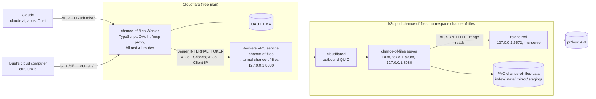

# Chance of Files v2: the core moves home

**Status:** revision 3, 2026-10-31. Phase 0 (spikes) is done: [rclone results](phase0-rclone.md), [network results](phase0-network.md). The owner approved D1–D3, D5 and D6; D4 was settled by measurement. Nothing else is built yet.
**Scope:** move the MCP core off Cloudflare Workers onto the owner's cm3588 (single-node k3s, RK3588 arm64, 32 GB RAM, NVMe Btrfs RAID1, 3.7 TB free at `/srv/data`), and grow it from five read-only tools into full drive access: writes, a whole-drive index, a local mirror with full-text search, and expiring links for big transfers.

**Settled by the owner:** the name is Chance of Files; pCloud stays the source of truth; the Crypto Folder is never exposed; `/Backups/Immich` is visible and indexed but never written; deletes go to pCloud's trash; every write and delete asks first; no Workers Paid; the owner's personal config lives in the private repo `tywrr/cm3588-armbian` under `k8s/chance-of-files`. The design decisions **(D1)** to **(D6)**, marked where they come up, are all settled; see [Decisions for the owner](#decisions-for-the-owner).

## Goals and non-goals

| Goals | Non-goals |
|---|---|
| Full access over MCP: list, read (text paged; images; PDF, DOCX/XLSX/PPTX, EML/MBOX as text; other binaries as metadata plus a download link), create folder, move/rename, copy, upload, delete to pCloud's trash | Permanent deletes, emptying the trash, pCloud Rewind |
| A metadata index of the whole drive (~140k entries, 408 GiB; Immich ~133k of them) answering audit questions inside Claude's ~150k-character per-call cap | Two-way sync |
| A one-way mirror (pCloud → disk, ~20–40 GB, no Immich, no Crypto Folder) and full-text search over mail, notes, PDFs and documents | Photo contents, OCR, embeddings |
| Expiring download links (single files with `Range`; streamed zips) and chunked upload links, for Duet's cloud computer | Public sharing |
| Everything on the Workers **free** plan: the OAuth front stays a Worker, the Rust core runs in the cluster | Workers Paid, a Workers-only v2 core (D6) |
| Public repo ships every capability with generic defaults; personal values live in the private overlay | Personal hostnames, IDs or folder rules in the public repo |

## Components and request flow



One pod, three containers sharing loopback; nothing listens on the pod IP. The pod gets a **new** tunnel and VPC service (both named `chance-of-files`), so v2 runs side by side with today's stack and the cutover is a connector swap in claude.ai (see [Migration](#migration)).

A tool call: Claude → auth Worker (checks the OAuth token, swaps in `INTERNAL_TOKEN`, adds the grant's scopes) → VPC binding → cloudflared → core (constant-time token check, scope check, JSON-RPC, `Policy`, tool) → index/mirror, or rclone for live pCloud calls.

A link: Duet's computer → `https://chance-of-files.<sub>.workers.dev/dl/<token>/<name>` → the Worker checks HMAC and expiry (junk never reaches the cluster), rate-limits, forwards with `INTERNAL_TOKEN` and the client IP → the core checks the link row, IP binding and byte cap, then streams. The Worker returns the core's response body untouched, so CPU stays far under the free plan's 10 ms.

## The core

**(D1) Keep `crates/core`'s hand-written stateless endpoint on tokio + axum; don't adopt rmcp's server runtime.** It already handles the protocol eras (2025-03-26 through 2026-07-28's per-request `_meta`), origin checks and the guide, and is tested; rmcp's runtime would mean rewriting dispatch to gain sessions and SSE we don't need. `rmcp::model` stays for types. Native changes:

- `Storage` futures become `Send` (`#[trait_variant::make(Send)]`).
- The Workers limits go (10 ms CPU, 50 subrequests, `MAX_LISTING_BYTES`, `SEARCH_SKIP`). Claude's cap stays: every tool has a **120,000-character output budget** and pages with an opaque cursor.
- **Per-call deadline: 180 s** (`server.deadline`). Claude allows 240 s. Phase 0 held quiet responses open for 90, 150 and 200 s through Claude → workers.dev → Worker (free plan) → VPC → tunnel → cloudflared, as plain HTTP and as MCP tool calls from claude.ai, and all of them completed ([network results](phase0-network.md)); the deadline is the longest that passed minus 20 s. Tools never rely on it: past the deadline they return what they have plus a cursor, and anything long (folder moves/copies, purges, refreshes) is an async job.
- Config is one TOML file; secrets come from env.

## Crate layout

| Crate | Status | What |
|---|---|---|
| `crates/core` | changed | MCP endpoint, tools, `Storage` traits, `Policy`, scopes, paging and budgets. No I/O; tests against an in-memory store |
| `crates/rclone` | new | `Storage` over rclone's remote-control API |
| `crates/webdav` | kept, gains writes | `Storage` over WebDAV for local folders/NAS; `PUT`/`MKCOL`/`MOVE`/`COPY`, no delete (no trash) |
| `crates/index` | new | SQLite schema, walk/diff, audit queries, FTS |
| `crates/extract` | new | Text extraction: PDF (via `pdftotext`), OOXML, EML, MBOX, HTML, plain text |
| `crates/server` (binary `chance-of-files`) | new | axum app, config, background jobs, `/dl` `/ul` handlers |
| `crates/pcloud` (`pcloud-sdk`) | later | Direct pCloud API backend, once pCloud approves the OAuth app |
| `crates/worker` | **removed** | v0.1.x stays tagged (D6) |
| `auth/` | changed | VPC binding, `files:write` consent checkbox, scope/IP headers, `/dl` `/ul` routes |

**Images.** The core image is `ghcr.io/tywrr/chance-of-files`, Debian-slim based, multi-arch (arm64, amd64), built by CI on tags, containing the binary and `poppler-utils` (`pdftotext`) only. rclone and cloudflared stay on their pinned upstream images (`rclone/rclone`, `cloudflare/cloudflared`, by version and digest), so their upgrades are independent.

## Backend: rclone rcd

**(D2) Talk to pCloud through `rclone rcd` on loopback**, not WebDAV (no trash semantics, no hashes, XML) and not the pCloud API with rclone's token (that uses rclone's app registration outside rclone; it waits for our own app).

rclone runs `rcd --rc-addr=127.0.0.1:5572 --rc-user=core --rc-pass=$RC_PASS --rc-serve --tpslimit=8`, remote from env vars as today, with **no `--filter-from`** or any other filter. Calls used: `operations/list` (never with `_filter`), `stat` (with `showHash`), `mkdir`, `movefile`, `copyfile`, `deletefile`, `purge`, `about`, `fsinfo`, `uploadfile`; `sync/move`, `sync/copy`, `sync/sync`; `job/status`, `job/list`; `--rc-serve` for ranged reads. Every call that can run long is sent with `_async: true`.

**No filters in rclone, ever.** The rclone client never sends `_filter` on recursive `operations/list` calls or on `sync/*`. Phase 0 showed why: any directory filter makes rclone drop pCloud's recursive listing (ListR) and list folder by folder (Immich: 6 s → 133 s, 3 → 6,029 API calls), and it turns a folder move from one `renamefolder` call into per-file moves that leave the source folder behind ([rclone results](phase0-rclone.md), rows 1d and 6). Filters don't protect anything anyway (next paragraph), so exclusions are done by the core: `Policy` for hidden paths, the split walk for roots.

**The core's `Policy` is the only enforcement point for hidden and protected paths.** rclone's filters apply to listings and syncs, not to single-object rc operations or to `--rc-serve` URLs: phase 0 ran `stat`, `copyfile` (a hidden file copied out to a visible path), `deletefile` and an rc-serve `GET` on a filtered path, and all of them went through (row 4). So there is no second layer. In code, the rclone client accepts only a `CheckedPath` newtype that `Policy` alone can construct, and it has no method for `operations/cleanup` or `publiclink` (an integration test asserts neither can be sent).

**`--rc-serve` caveats** (row 3). Ranged `GET`s and `HEAD` work, but:

- The core validates `Range` against the stat'ed size itself and answers 416 for an unsatisfiable range; rclone answers it with a malformed, empty `206`. Multi-range requests are refused (rclone returns 400).
- rc-serve also serves **local paths** in the rclone container (`/[/abs/dir]/file`). The core builds URLs only from the fixed configured remote name plus a percent-encoded `CheckedPath` (`/[<remote>:]/<path>`), never from caller input, and `RC_PASS` is treated as root-equivalent: it stays inside the pod, on loopback, and is never logged or passed to subprocesses.

### Storage traits

```rust
pub struct Capabilities { pub trash_on_delete: bool, pub hashes: Vec<HashKind>, pub server_dir_move: bool } // server_dir_move holds only with no filter
pub enum Done { Now(Entry), Job(JobId) }   // folder ops on rclone return a job

#[trait_variant::make(Send)]
pub trait Storage {
    fn capabilities(&self) -> Capabilities;           // hashes from operations/fsinfo (US: md5, sha1)
    async fn list(&self, path: &CheckedPath) -> Result<Vec<Entry>, StorageError>;
    async fn walk(&self, root: &CheckedPath, exclude: &[CheckedPath]) -> Result<Vec<Entry>, StorageError>;
    async fn stat(&self, path: &CheckedPath, with_hash: bool) -> Result<Entry, StorageError>;
    async fn open(&self, path: &CheckedPath, range: Option<ByteRange>) -> Result<ByteStream, StorageError>;
}

#[trait_variant::make(Send)]
pub trait StorageWrite: Storage {
    async fn mkdir(&self, path: &CheckedPath) -> Result<Entry, StorageError>;
    async fn rename(&self, from: &CheckedPath, to: &CheckedPath) -> Result<Done, StorageError>; // files: movefile; folders: sync/move
    async fn copy(&self, from: &CheckedPath, to: &CheckedPath) -> Result<Done, StorageError>;   // folders: sync/copy, async
    async fn trash(&self, path: &CheckedPath) -> Result<Done, StorageError>;   // refused unless trash_on_delete; folders: purge, async
    async fn put_local(&self, local: &Path, to: &CheckedPath) -> Result<Entry, StorageError>;
    async fn job(&self, id: &JobId) -> Result<JobState, StorageError>;
}
```

`Entry` gains `id` (pCloud's `f123`/`d456`, taken directly from rclone's `ID`) and `hashes`. `StorageError` gains `AlreadyExists`, `Protected`, `Unsupported`, `Unhealthy`. Folder moves use `sync/move` with `deleteEmptySrcDirs`; with no filter active, rclone makes it **one `renamefolder` call** (phase 0, row 6). pCloud's mtime precision is 1 s, so freshness checks compare mtimes at second granularity.

**Hashes are expensive.** `fsinfo` reports md5 and sha1, but pCloud listings carry no hashes: each file's hash is one extra API call (`lsjson --hash` on 74 files: 12.5 s, against 0.37 s without). Walks never ask for hashes; hashing stays lazy (`get_file_info hash=true`) and limited to size collisions in `find_duplicates`.

**Trash.** `deletefile` (files) and `purge` (folders) through rclone rc call pCloud's `deletefile` / `deletefolderrecursive`, and the owner confirmed in the pCloud web Trash that both land in pCloud's trash. `trash_on_delete` is `true` for pCloud, and `delete` is enabled for files and folders. The pCloud backend has no hard-delete option; permanent deletion (`operations/cleanup`) is never sent.

## Policy, scopes and annotations

`Policy` runs before any backend call, on normalized, case- and NFC-folded paths:

| Rule | Effect | Public default | Owner |
|---|---|---|---|
| `hidden` | Never listed, indexed, mirrored, linked, read or written; errors say "not found" | `["/Crypto Folder"]` | same |
| `protected` | Visible, indexed, readable, linkable; any write whose source, destination, or an ancestor/descendant of either is protected is refused | `[]` | `["/Backups/Immich"]` |
| `no_mirror`, `no_text` | Kept out of the mirror / full-text index | `[]` | Immich |

Moving or deleting `/`, or a folder containing a protected path, is refused. The guide (`/AGENTS.md`, first 8 KiB) goes into the instructions as today, followed by the list of protected folders.

**Scopes.** The OAuth front offers two scopes: `files:read` (always granted) and `files:write`. The consent page has an unchecked-by-default checkbox, "Allow changes: create, move, copy, upload, delete to trash"; the grant gets `files:write` only if it is ticked, whatever the client requested. The Worker strips any client-sent `X-CoF-*` headers and forwards the grant's scopes as `X-CoF-Scopes`; the core trusts that header only on requests that carried a valid `INTERNAL_TOKEN` (which is every request it serves). Without `files:write`, `tools/list` omits the write tools and a call to one fails with an authorization error. To change it, the owner reconnects the connector. The server-wide `[writes] tools` list still applies on top (empty = read-only server).

**Annotations.** Every tool that changes pCloud, plus `create_upload_link` and `create_download_link`, has `destructiveHint: true`, so Claude asks before each one. A download link counts because it lets data leave: a prompt injection in an indexed email could otherwise ask for one quietly.

## Tools

Results are text with a header line, e.g. `[rows 1-500 of 13,204 · / as of 14:05Z, /Backups/Immich as of 09:00Z · next cursor=…]`, plus `backend unhealthy since 13:40Z: <error>` when the health check is failing. Audit tools also return `structuredContent`. Cursors encode the last row's sort key and the index generation.

| Tool | Arguments (sketch) | Scope | Annotations | Source |
|---|---|---|---|---|
| `list_folder` | `path`, `sort`, `cursor`, `live` | read | read-only | index; `live` → rclone |
| `get_file_info` | `path`, `hash` | read | read-only | live stat (hashes on request) + index totals |
| `read_text_file` | `path`, `offset`, `max_bytes` (≤100 kB) | read | read-only | mirror if fresh, else rclone range read |
| `read_image` | `path`, `max_edge` (1568) | read | read-only | PNG/JPEG/GIF/WebP downscaled to ≤1.5 MiB; others → metadata |
| `read_document` | `path`, `page`/`message`/`cursor` | read | read-only | PDF pages, DOCX, PPTX, XLSX rows as TSV, EML, one MBOX message |
| `search_files` | `query`, `path`, `kind`, `cursor` | read | read-only | index, names, whole drive |
| `search_content` | `query` (FTS5), `path`, `kind`, `from`, `after`, `before`, `cursor` | read | read-only | text.db: path, locator, date, sender, subject, snippet |
| `folder_stats` | `path`, `depth` (1–3), `sort`, `cursor` | read | read-only | per-folder totals across roots |
| `query_files` | `path`, `kind`, `ext`, size and date bounds, `sort`, `cursor` | read | read-only | "largest files", "all .mov over 1 GB" |
| `find_duplicates` | `path`, `min_size`, `cursor` | read | read-only | size, then hash |
| `recent_changes` | `since`, `path`, `source`, `cursor` | read | read-only | change log (walks and own writes) |
| `type_breakdown` | `path` | read | read-only | count and bytes per kind/extension |
| `index_status` | | read | read-only | per-root times, errors, pending mass removals, mirror/FTS progress, backend health |
| `refresh_index` | `path`, `confirm` | read | read-only*, idempotent | async re-walk; `confirm` applies a held mass removal |
| `job_status` | `id` or none (recent jobs) | read | read-only | async folder move/copy/delete progress |
| `create_folder` | `path` | write | destructive, idempotent | |
| `move` | `from`, `to`, `overwrite=false` | write | destructive | files now; folders → job id |
| `copy` | `from`, `to`, `overwrite=false` | write | destructive | server-side; folders → job id |
| `write_file` | `path`, `text` or `base64`, `overwrite=false` | write | destructive | ≤5 MB inline; bigger → upload link |
| `delete` | `path` | write | destructive | to pCloud's trash; folders → `purge` job |
| `create_upload_link` | `folder`, `name`, `size`, `overwrite=false`, `expires_in` | write | destructive, open-world | |
| `create_download_link` | `paths[]`, `zip=false`, `expires_in` (15 min, max 24 h) | read | destructive, open-world | |
| `list_links` / `revoke_link` | `id` | read | read-only / destructive | usage per link: IPs, ranges, bytes |

\*`refresh_index` changes only the cache. Every write updates the index (and mirror, see below) when pCloud confirms; async jobs re-walk the affected subtrees when they finish, and `job_status` reports `done`, `failed` or `lost`.

## Index

**(D3) SQLite (rusqlite, bundled, WAL) with FTS5, not tantivy.** The audit tools are SQL aggregates; one engine keeps one writer and one backup story. Three files: `index.db` and `text.db` are caches that can be rebuilt from pCloud; `state.db` holds what can't be (links, jobs, own-write audit log) and is small. No `chattr +C`: the files keep Btrfs checksums and RAID1 self-healing; WAL handles the write pattern fine.

```sql
-- index.db
entries(id INTEGER PRIMARY KEY, remote_id TEXT, path TEXT UNIQUE, parent TEXT, name TEXT, name_fold TEXT,
        is_dir INT, size INT, mtime INT, ext TEXT, kind TEXT, root TEXT, gen INT,
        own_write_at INT, deleted_at INT)        -- set by our writes; deleted_at = tombstone
hashes(remote_id TEXT PRIMARY KEY, size INT, mtime INT, sha1 TEXT, md5 TEXT, sha256 TEXT)
folder_totals(path TEXT PRIMARY KEY, files INT, dirs INT, bytes INT, newest INT)
changes(seq INTEGER PRIMARY KEY, at INT, op TEXT, path TEXT, old_path TEXT, size INT, source TEXT)
roots(path TEXT PRIMARY KEY, every_s INT, walk_started INT, last_ok INT, last_error TEXT, gen INT,
      entries INT, pending_removals INT)
-- state.db
links(id TEXT PRIMARY KEY, kind TEXT, paths TEXT, created INT, expires INT, bound_net TEXT,
      max_bytes INT, bytes_served INT, state TEXT)
link_log(at INT, link_id TEXT, ip TEXT, range TEXT, bytes INT, status INT)
jobs(id TEXT PRIMARY KEY, rc_jobid INT, op TEXT, src TEXT, dst TEXT, started INT, finished INT, state TEXT, error TEXT)
audit(seq INTEGER PRIMARY KEY, at INT, tool TEXT, args TEXT, result TEXT)
-- text.db
docs(id INTEGER PRIMARY KEY, path TEXT UNIQUE, size INT, mtime INT, extractor TEXT, status TEXT, error TEXT)
chunks(id INTEGER PRIMARY KEY, doc_id INT, locator TEXT, offset INT, length INT,
       date INT, sender TEXT, recipients TEXT, subject TEXT, body TEXT)
chunks_fts USING fts5(subject, sender, recipients, body, content='chunks', content_rowid='id',
                      tokenize='unicode61 remove_diacritics 2')
```

**Roots are non-overlapping.** Config lists roots (public default `/`; owner adds `/Backups/Immich`). A parent root's walk excludes every child root, and every `hidden` path, by **splitting the tree** rather than filtering: each ancestor of an excluded path is listed non-recursively, and every sibling subtree is listed recursively with no filter. For the owner's `/` that means listing `/` and `/Backups` non-recursively and every other top-level folder (and every other child of `/Backups`) recursively: ~12 API calls, ~4 s at `--tpslimit=8`, against 716 calls and 90 s with `_filter`. Hidden folders are never fetched at all, and each entry belongs to exactly one root; the folder entry of a child root comes from its parent's walk. `folder_totals` is computed over all entries, so `/`'s totals include Immich; headers show each contributing root's own "as of".

**Walks.** The split listing above per root (a root with nothing excluded below it is one `operations/list` with `recurse: true`), every 30 min by default (owner: Immich every 6 h). Walks run one at a time. Measured: Immich, 132,648 entries, ~6 s and ~440 MB peak RSS in rclone, with a 35 MB JSON response that the core parses as a stream. rclone already avoids pCloud's error 1101 on `/` by listing root non-recursively, and the split walk never asks for `recursive` on the root anyway. The walk records `walk_started` before it lists. Applying it: adds, size/mtime changes and moves (same `remote_id`, new path) become `changes` rows, and rows not seen are removed, **except** that rows with `own_write_at > walk_started` are kept as written, and tombstones with `deleted_at > walk_started` are not re-added. Tombstones are dropped once a walk that started after them completes. A failed walk leaves the previous generation and records `last_error`.

**Mass-removal guard.** A walk that would remove more than 5% of a root's entries applies its adds and changes but holds the removals; `index_status` shows "walk of / at 14:05Z would remove 7,412 entries (6.1%)", and `refresh_index path=/ confirm=true` applies them. A flaky listing therefore can't empty the index (or, through it, the mirror).

**Duplicates.** Group by size in SQL, then for size collisions ≥ `min_size` (1 MiB) fetch hashes per file with `operations/stat` and `showHash` (one API call each, ~0.2–0.7 s), using the hash kind the backend reports in `fsinfo` (US region: SHA-1 and MD5). Cached in `hashes` while size and mtime match; a background job fills collisions after each walk, 4 at a time, under the `--tpslimit`.

## Mirror and full text

**Mirror** (`/data/mirror`, scope = `[mirror] include` minus `hidden` and `no_mirror`; owner ~20–40 GB). It is driven by the index diff: each applied walk's `changes` in scope become per-entry `operations/copyfile` / `deletefile` calls (from pCloud to the local remote); own writes are applied after pCloud confirms. A daily `sync/sync` reconcile (async jobs, `--max-delete 500`) catches drift. Since rclone runs without filters, the reconcile splits the tree like a walk: one `sync/sync` per in-scope subtree that contains no `hidden` or `no_mirror` path, and plain file copies in the ancestors of those paths, so nothing out of scope is ever fetched. Write-through and the reconcile share one lock: write-through queues while a sync runs, and a sync doesn't start while write-through is pending. The mirror is a cache: a read does a live `stat` (cached 30 s) and serves the mirror copy only if size and mtime match, otherwise reads through rclone and re-queues the file.

**Extraction** runs on changed mirror files matching `[text] include` (default `*.md *.txt *.pdf *.docx *.xlsx *.pptx *.eml *.mbox *.html`; owner adds the Runbox and Takeout paths). Two workers, 120 s timeout each. Subprocesses run with a **cleared environment** (no `RC_PASS`, `LINK_KEY`, `INTERNAL_TOKEN`), `RLIMIT_AS`, and the mirror path as their only argument.

| Format | How |
|---|---|
| PDF | `pdftotext -layout`, one chunk per page; scanned PDFs are marked `no text` |
| DOCX / PPTX | `zip` + `quick-xml`; decompressed size capped (zip-bomb guard) |
| XLSX | `calamine`, one chunk per sheet × 500 rows, TSV |
| EML | `mail-parser`: headers, text part, HTML → text; attachment names only |
| MBOX | Streamed, split on `From ` (mboxrd), each message a chunk with byte `offset`/`length`, so `read_document` re-reads one message by range |

## Links

**Links go through the auth Worker on workers.dev; there is no public tunnel hostname.** One allowlisted domain for Duet, no egress fees, nothing new exposed on the cluster. Every request body through Cloudflare is capped at 100 MB on the free plan (Worker or proxied hostname alike), so **chunked uploads in parts ≤ 90 MB are the only upload path**.

| | Design |
|---|---|
| URL | `https://<front>/dl/<id>.<exp>.<mac>/<filename>` and `/ul/<id>.<exp>.<mac>` |
| Token | `id` 128 random bits; `mac` = HMAC-SHA256(`LINK_KEY`, kind ‖ id ‖ exp), 128 bits. `LINK_KEY` on the Worker (pre-check) and the core (authoritative); rotating it revokes all links |
| Expiry | Default **15 min**, max 24 h |
| IP binding | A minor layer (D4, below). The first client to use a link binds it to its /24 for IPv4, /64 for IPv6; later requests from elsewhere get 403 and are logged. The Worker forwards `CF-Connecting-IP` as `X-CoF-Client-IP`, trusted only with `INTERNAL_TOKEN` |
| Byte cap | Per link: 3× the payload size (resumes and retries), then 410 |
| Reuse | Multi-use within expiry, cap and binding; `list_links` shows every use, `revoke_link` kills one. Upload links die on completion |
| Scope | Download: listed paths, never `hidden`. Upload: one destination, `protected` refused at creation and completion, `overwrite` fixed at creation |
| Headers | `Content-Disposition: attachment`, `application/octet-stream`, `nosniff`, `Cache-Control: no-store`, `CSP: sandbox` (the links share an origin with the OAuth pages) |
| Rate | 60/min per IP on `/dl` and `/ul` in the Worker; bad MACs never reach the cluster |
| Logging | Every use in `link_log` (IP, range, bytes, status) |

**What actually protects a link.** Phase 0 measured where Claude's traffic comes from ([network results](phase0-network.md), D4): Duet's 2 GiB download came from one address (160.79.106.131), but claude.ai's MCP calls came from about 15 addresses in 160.79.106.0/24, part of Anthropic's shared egress 160.79.104.0/21. Exact-IP binding would therefore break legitimate retries, and a /24 binding only keeps out the open internet, not other Claude users who share that egress. So binding to the first /24 stays, but only as a minor layer. The real protections are:

- the URL itself: 128 random bits plus a 128-bit HMAC, unguessable, never logged in full;
- the **15-minute** default expiry (24 h only when asked for);
- the per-link byte cap (3× the payload);
- `destructiveHint` on `create_download_link` and `create_upload_link`, so Claude asks the owner before every link;
- `list_links` and `revoke_link`, and the per-use log (IP, range, bytes, status).

**Single-file downloads** stream from the mirror when fresh, else from rclone's `--rc-serve`, with `Accept-Ranges` and `Range` passed through after the core has validated the range (416 itself for an unsatisfiable one), so `curl -C -` resumes. Phase 0: a 2 GiB download through the free Worker arrived intact at 18.3 MiB/s from the laptop and ~20.5 MB/s on Duet's computer (one allowlisted host, the workers.dev name), and `Range` resume worked.

**Zips are streamed and not resumable.** STORE (photos and PDFs don't shrink) with ZIP64 and data descriptors, CRC-32 computed while streaming; no `Content-Length` guarantee, no `Accept-Ranges`. A dropped transfer restarts from zero within the byte cap. Precomputing CRCs would make zips resumable but means reading every byte twice from pCloud before the link exists; not worth it. Default cap 10 GB per zip (D5); above that, or for anything you'd hate to restart, `create_download_link` with `zip=false` returns one link per file plus a manifest (path, size, SHA-1) and a shell snippet that fetches with `curl -C -` and verifies.

**Uploads**: `PUT /ul/<token>` with `Content-Range: bytes a-b/total`, parts ≤ 90 MB, in order; `HEAD` returns the committed offset; the last part triggers completion: `put_local` (`operations/copyfile` from `staging`), size and SHA-1 check, index and mirror write-through, staging deleted. `create_upload_link` returns a ready-to-run `split -b 90M` + `curl` snippet. Phase 0: 2 GiB as 22 × 90 MiB parts arrived intact at 10.9 MiB/s. Creating the link reserves `size` against the staging budget; abandoned staging is swept at expiry.

## Failure modes

| Failure | Detection | Behaviour |
|---|---|---|
| pCloud token revoked, expired, or rate-limited | `operations/about` (0.16 s) every 5 min and on rc errors | Index tools keep answering with their "as of"; every header shows `backend unhealthy since …: <error>`; live reads and writes fail fast with that message; walks pause with backoff. `--tpslimit` keeps us under pCloud's limits; a revoked token needs `apply-secrets.sh --rotate` |
| Disk full | `statvfs` before mirror copies, extraction and link creation | Config budgets `mirror.max_bytes`, `links.staging_max_bytes`, `disk.reserve` (default 20 GB free). Upload links reserve their size at creation and are refused if it doesn't fit; the mirror stops adding and says so in `index_status`. Owner: `/srv/data/chance-of-files` is its own Btrfs subvolume with a qgroup limit (200 GB), so a runaway can't fill `/srv/data` |
| Pod restart mid-upload | Staging file + `links` row survive on the PV | `HEAD` reports the committed offset; the client resumes |
| Pod restart mid-zip or download | Stream breaks | Single files resume with `Range`; zips restart from zero |
| rclone restart mid-job | `job/list` doesn't know a running `jobs` row | Row marked `lost`, affected subtrees re-walked, `job_status` says to check and retry |
| Restart mid-extraction | `docs.status = running` at startup | Reset to `pending` |
| SQLite corruption | `PRAGMA quick_check` at startup, I/O errors | `index.db`/`text.db`: moved aside and rebuilt from a walk and re-extraction. `state.db`: moved aside, a fresh one started (links lost, audit kept in the old file); the owner's Btrfs snapshots cover it |
| Mirror drift | Read-path size/mtime check; daily reconcile | Stale file re-copied; reconcile bounded by `--max-delete` and the mass-removal guard |
| Cloudflare path cuts a long call | `server.deadline` 180 s (200 s measured to pass) | Deadline + cursors + async jobs; no call depends on running long |

## Configuration: public base, private overlay

Public repo, `deploy/k8s/base/` (kustomize): Namespace (`pod-security.kubernetes.io/enforce: restricted`), Deployment `chance-of-files` (`replicas: 1`, `strategy: Recreate`, three containers, `fsGroup: 65532`), NetworkPolicy (no ingress; egress 443/7844 and DNS), PVC `chance-of-files-data` (50 Gi, default StorageClass), ConfigMap `chance-of-files-config` from `config.example.toml`, and Secret `chance-of-files` created out of band by `deploy/k8s/apply-secrets.sh` (pCloud token, `RC_PASS`, `INTERNAL_TOKEN`, `LINK_KEY`, tunnel token). No hostPath anywhere: the restricted profile rejects it.

```toml
# config.example.toml (generic defaults; every option documented inline)
server  = { listen = "127.0.0.1:8080", guide = "/AGENTS.md", deadline = "180s" }
backend = { kind = "rclone", url = "http://127.0.0.1:5572", remote = "pcloud:", health_every = "5m" }
paths   = { hidden = ["/Crypto Folder"], protected = [], no_mirror = [], no_text = [] }
index   = { dir = "/data/index", roots = [{ path = "/", every = "30m" }], max_removal = 0.05 }
mirror  = { enabled = false, dir = "/data/mirror", include = ["/**"], max_bytes = "50GB", reconcile = "daily", max_delete = 500 }
text    = { enabled = false, include = ["**/*.md", "**/*.txt", "**/*.pdf", "**/*.docx", "**/*.eml", "**/*.mbox"] }
writes  = { tools = ["create_folder", "move", "copy", "write_file", "delete"], max_inline_bytes = 5_000_000 }
links   = { default_ttl = "15m", max_ttl = "24h", bind = "net", max_zip_bytes = "10GB", staging = "/data/staging", staging_max_bytes = "30GB" }
disk    = { reserve = "20GB" }
```

Private repo `tywrr/cm3588-armbian`, `k8s/chance-of-files/`: the base pinned to a tag, the image pinned by digest, the PVC bound to a `local` PersistentVolume on `/srv/data/chance-of-files`, and the owner's `config.toml`. The host side (subvolume, qgroup, `chown 65532:65532`) belongs to that repo's provisioning.

```yaml
# k8s/chance-of-files/kustomization.yaml
apiVersion: kustomize.config.k8s.io/v1beta1
kind: Kustomization
namespace: chance-of-files
resources:
  - https://github.com/tywrr/chance-of-files//deploy/k8s/base?ref=v0.2.0
  - pv.yaml
images:
  - name: ghcr.io/tywrr/chance-of-files
    digest: sha256:<digest of v0.2.0>
configMapGenerator:
  - name: chance-of-files-config
    behavior: replace
    files: [config.toml]   # Immich root (6 h), protected + no_mirror; Runbox/Takeout text rules; mirror include
patches:
  - patch: |-
      apiVersion: v1
      kind: PersistentVolumeClaim
      metadata: { name: chance-of-files-data }
      spec:
        storageClassName: local-static
        volumeName: chance-of-files-data
        resources: { requests: { storage: 200Gi } }
  - patch: |-
      apiVersion: apps/v1
      kind: Deployment
      metadata: { name: chance-of-files }
      spec:
        template:
          spec:
            containers:
              - { name: core, resources: { limits: { cpu: "2", memory: 2Gi } } }
---
# k8s/chance-of-files/pv.yaml (cluster-scoped; the namespace transformer leaves it alone)
apiVersion: v1
kind: PersistentVolume
metadata: { name: chance-of-files-data }
spec:
  capacity: { storage: 200Gi }
  accessModes: [ReadWriteOnce]
  persistentVolumeReclaimPolicy: Retain
  storageClassName: local-static        # no provisioner; bound by volumeName
  volumeMode: Filesystem
  local: { path: /srv/data/chance-of-files }
  nodeAffinity:
    required:
      nodeSelectorTerms:
        - matchExpressions:
            - { key: kubernetes.io/hostname, operator: In, values: [cm3588] }   # kubectl get nodes
```

The auth Worker's personal values (VPC `service_id`, KV id) live in a gitignored `auth/wrangler.personal.jsonc`, used by `mise run deploy:auth` when present and backed up in the private repo; the public `auth/wrangler.jsonc` keeps `<SERVICE_ID>` placeholders.

## Security posture

- OAuth front as today (CIMD/DCR, passphrase, hashed tokens, `DCR_ALLOWED_CIDRS`), plus the `files:write` checkbox. Write access exists only on grants where the owner ticked it.
- `INTERNAL_TOKEN` between front and core, constant-time; the core refuses everything without it and trusts `X-CoF-*` headers only with it. rclone rc has its own Basic auth on loopback.
- No inbound ports; the tunnel has no public hostname; NetworkPolicy denies ingress.
- Pod security `restricted`: non-root 65532, read-only root FS, no capabilities, seccomp RuntimeDefault, no service-account token, no hostPath.
- rclone rc: `RC_PASS` is root-equivalent (rc-serve also reads local files in the rclone container), so it never leaves the pod; rc-serve URLs are built only from the fixed remote name and a `CheckedPath`. No filters run in rclone; `Policy` is the only enforcement.
- Prompt injection gets more reach with writes and links. Guards: Claude asks before every write and every link; trash-only deletes; `protected`; links expire in 15 min by default, have a byte cap, can be listed and revoked, and every use is logged (the /24 binding is a minor extra, since Claude's egress is shared); `audit` and `recent_changes source=own-write` record every change; the read-only switch.

## Resources

| Container | Requests | Limits | Notes |
|---|---|---|---|
| core | 100m, 256 Mi | 2 CPU, 2 Gi | Parses Immich's 35 MB listing as a stream and diffs it (~300 MB budget); 2 extraction workers |
| rclone | 50m, 128 Mi | 2 CPU, 1 Gi | Measured peaks: idle 84 MB, Immich walk ~440 MB, split walk of `/` ~110 MB, unfiltered `/` ~520 MB (never done). 1 Gi leaves ~2× headroom because walks run one at a time |
| cloudflared | 10m, 32 Mi | –, 256 Mi | As today |
| Disk | | 200 GB qgroup | ~45 GB mirror, ~5 GB index, staging ≤ 30 GB |

Index queries < 50 ms; live `stat` ~0.3 s (0.7 s with a hash); `about` 0.16 s; first full walk ~10 s (Immich ~6 s + the rest ~4 s), plus index insert time. Transfers are bound by the home uplink: ~18–20 MiB/s down, ~11 MiB/s up in phase 0.

## Risks

- **Workers VPC is free only while in beta.** If it gets a price the owner won't pay, the fallback is a tunnel public hostname on a zone the owner has on Cloudflare, protected by a Cloudflare Access service-token policy; the Worker sends `CF-Access-Client-Id`/`-Secret` (Worker secrets) on every request, and the core still requires `INTERNAL_TOKEN`. Same 100 MB body cap, same chunked uploads. The front keeps one `CORE` fetch abstraction so this is a config switch.
- **Long transfers through the free Worker.** Proven at 2 GiB: downloads from the laptop and from Duet and a 22-part chunked upload all arrived intact. The 3 × 20 GiB download test was skipped (it would tie up the home uplink for hours), so multi-hour transfers through one Worker request remain unproven; per-file links with `curl -C -` resume if one is cut.
- **Shared egress.** Claude's and Duet's traffic leaves from Anthropic's shared range, so the link IP binding can't tell the owner's sessions from other Claude users'. Short expiry, the byte cap, asking before each link and revocation carry the weight (see [Links](#links)).

## Migration

Today, live: Workers `pcloud-mcp` (auth) and `pcloud-mcp-core` on workers.dev → VPC service `pcloud-laptop` (127.0.0.1:8080) → tunnel `pcloud-mcp` → namespace `pcloud-mcp`, Deployment `pcloud-mcp-backend` (rclone serve webdav + cloudflared) on the cm3588. v2 runs next to it in namespace `chance-of-files` with its own tunnel and VPC service, so nothing old changes until step 5.

**Precondition at every step: one cloudflared connector per tunnel** (Cloudflare spreads requests across all connectors of a tunnel). Before and after each step, run:

```bash
kubectl get pods -A -o jsonpath='{range .items[*]}{.metadata.namespace}{"\t"}{.metadata.name}{"\t"}{.status.phase}{"\t"}{.spec.containers[*].image}{"\n"}{end}' | grep cloudflared
```

Expected: at most one `Running` line in `pcloud-mcp` (tunnel `pcloud-mcp`) and at most one in `chance-of-files` (tunnel `chance-of-files`), and no cloudflared anywhere else, such as the laptop's old systemd unit (`systemctl --user is-active chance-of-files-tunnel` → inactive). The Cloudflare dashboard's connector count for each tunnel must agree. `replicas: 1` with `Recreate` keeps it so during rollouts.

1. Owner creates tunnel `chance-of-files` and VPC service `chance-of-files` → `127.0.0.1:8080`; host provisioning creates the subvolume. Check.
2. Apply `k8s/chance-of-files` (base v0.2.0 + overlay) with the new tunnel token. Check. Smoke test the core through `kubectl port-forward` and the MCP Inspector.
3. Deploy the new auth Worker `chance-of-files` (free plan, new KV, fresh `INTERNAL_TOKEN` and `LINK_KEY`, `vpc_services` binding `CORE`). `chance-of-files-core` is never deployed. Check.
4. In claude.ai add `https://chance-of-files.<subdomain>.workers.dev/mcp` beside the old connector; sign in (with and without `files:write` once, to see both tool lists); check Duet sees the tools; then remove the old connector.
5. After a week: scale `pcloud-mcp-backend` to 0 (check: no cloudflared left in `pcloud-mcp`), delete Workers `pcloud-mcp` and `pcloud-mcp-core` and their KV, VPC service `pcloud-laptop`, tunnel `pcloud-mcp`, and namespace `pcloud-mcp`; confirm the account is on the Workers free plan.
6. After the first index walk (`index_status`), enable mirror and text in the overlay.

Rollback until step 5: re-add the old connector; the old stack never stopped.

## Testing

| Layer | How |
|---|---|
| Core tools | In-memory `Storage` with a trash; every tool ≤ 120k chars on a synthetic 150k-entry tree; cursors cover all rows without gaps or repeats |
| Policy | proptest: case, NFC/NFD, trailing slashes and `//` variants never reach the backend when `hidden`, never write when `protected`; `CheckedPath` is the only way into the rclone client. Filter-gap integration test: `stat`, `copyfile`, `deletefile` and rc-serve `GET` on a hidden path are never sent to rclone; rc-serve URLs never contain anything but the configured remote |
| Scopes | `tools/list` and write calls with and without `files:write`; `X-CoF-*` from clients stripped by the Worker and ignored by the core without `INTERNAL_TOKEN` |
| rclone backend | Real `rclone rcd` over a local remote in CI: no `_filter` on recursive lists or `sync/*`; split walk excludes child roots and hidden paths; unsatisfiable `Range` → 416 from the core. Opt-in live suite in `/Chance of Files test`: delete and `purge` land in trash, a folder move is exactly one `renamefolder` |
| Index | Walk-diff (adds, removes, moves by `remote_id`, failed walk); walk racing own writes and deletes; mass-removal hold and confirm; nested roots exclude children |
| Extraction | Golden files; zip bomb, malformed PDF, 2 GB mbox, timeouts; extractor sees an empty environment |
| Links | HMAC tamper/expiry, /24 IP binding, byte cap, `Range` on files, `unzip -t` on streamed zips, chunked upload with a dropped part and a pod restart |
| Failure modes | Revoked token (fake rc errors), disk-full budgets, corrupt `index.db` rebuild, lost rclone job |
| End to end | `mise run e2e`: rclone rcd + server + `wrangler dev` + MCP Inspector CLI, all local |

## Phased delivery

| Phase | Ships | Done when |
|---|---|---|
| 0. Spikes | Measurements only | **Done 2026-10-31**: [rclone results](phase0-rclone.md), [network results](phase0-network.md). No filters in rclone (split walks); Immich walk ~6 s; rc-serve ranges with core-side 416; filter gap confirmed incl. `copyfile`; `deletefile`/`purge` land in trash; folder move is one `renamefolder`; deadline 180 s; 2 GiB down/up and Duet's download intact; 3 × 20 GiB skipped; D4 settled |
| 1. Native parity (v0.2.0) | `crates/server`, `crates/rclone`, today's five tools, scopes, auth Worker on VPC, base + overlay, migration 1–5 | Old stack deleted, free plan only |
| 2. Index + audit (v0.3) | `crates/index`, roots, walk guards, audit tools, `index_status`, `refresh_index`, health check | Duet answers "where did my 408 GiB go" in one or two calls |
| 3. Writes + links (v0.4) | Write tools (folder `delete` included), jobs, `Policy` protected, links (files, streamed zips, chunked uploads), failure-mode handling | A 5 GB folder round-trips to Duet's computer and back |
| 4. Mirror + full text (v0.5) | Diff-driven mirror, reconcile, `crates/extract`, `read_document`, `search_content`, `read_image` downscaling | Duet finds a 2019 Runbox email by sender and phrase |
| 5. pCloud API backend | `pcloud-sdk`, `diff` feed, `getthumb` | When pCloud approves the app |

Docs (`README`, `architecture`, `setup`, `roadmap`) are rewritten in phase 1; the Workers-only setup moves to a "v0.1" note.

## Decisions for the owner

All settled. The owner approved D1–D3, D5 and D6 with the recommendations on 2026-10-31; D4 was settled by the phase 0 measurement.

1. **D1 Core runtime. Settled:** keep the hand-written stateless MCP endpoint on tokio + axum (not rmcp's server runtime); it's tested and sessions/SSE buy nothing here.
2. **D2 Backend until pCloud approves the app. Settled:** rclone rcd (not the pCloud API with rclone's token); the cost is polling (30 min, Immich 6 h) instead of live change events. Phase 0 added: no filters in rclone.
3. **D3 Index engine. Settled:** SQLite + FTS5 only, no tantivy; audit queries are SQL, and one engine is one backup story.
4. **D4 Link IP binding. Settled by measurement:** bind to the first client's /24 (/64 for IPv6), as a minor layer only. Exact IP would break: claude.ai's calls came from ~15 addresses in 160.79.106.0/24, and Duet's download from 160.79.106.131, all in Anthropic's shared egress 160.79.104.0/21. A /24 keeps out the open internet but not other Claude users, so expiry, byte cap, asking first, revocation and the use log are the real protections ([Links](#links), [network results](phase0-network.md)).
5. **D5 Zip size cap. Settled:** 10 GB per streamed zip, with per-file links above that; a non-resumable 25 GB transfer that drops at 90% is worse than a per-file manifest.
6. **D6 Workers-only core for other users. Settled:** retired; v0.2+ needs a machine that runs containers, v0.1.x stays tagged. Maintaining two cores would halve the effort on the one the owner uses.
